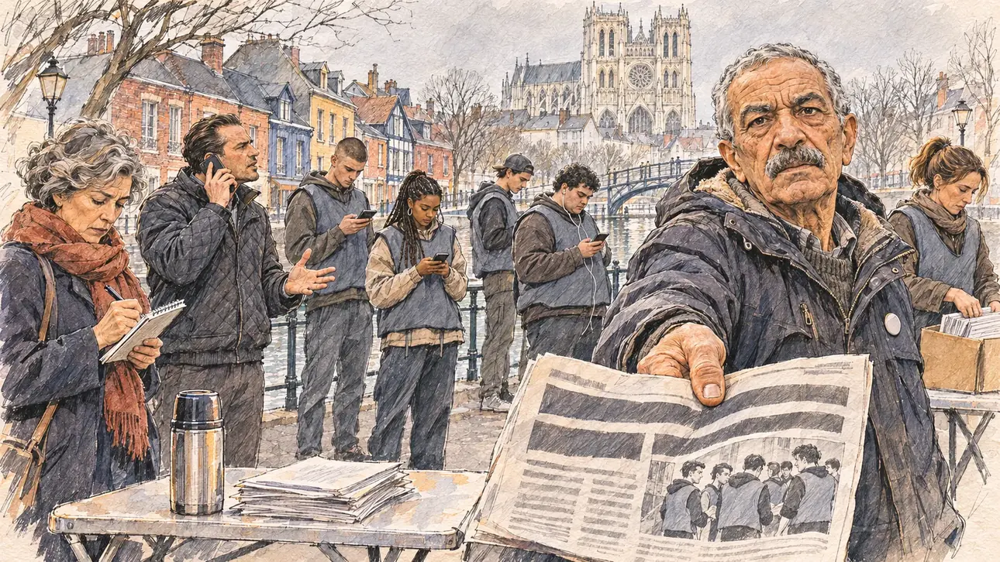

# `paidCanvassers` · Des militants rémunérés

**Validée par le PO le 05/11/2026**, au premier essai, avec `primeTime.webp` comme référence. Elle sert telle quelle en clair et en sombre.



| Champ | Valeur |
| --- | --- |
| Carte | `paidCanvassers`, catégorie `team` (Crise d'équipe), carte ajoutée par la PR #297 de l'app |
| Style | Reportage dessiné, trait de `primeTime` |
| Ton | Tendu et amer |
| Date | 2026-11-05 |
| Outil | ChatGPT Images |
| Conversation | À remplir (le lien ne s'ouvre qu'avec le compte qui l'a créée) |
| Format rendu | 1672 × 941 (16:9) : export en 1290 × 726 px, WebP de qualité 75, 248 Ko, sans recadrage |
| Fichier d'origine | Image de ChatGPT, chez le PO. L'export du dépôt a été fait depuis la copie partagée dans la conversation avec Claude |
| Première édition | La prochaine Release qui suit le merge de la PR #297 de l'app |

## Texte de la carte

> **Des militants rémunérés**
>
> Un quotidien local révèle que votre responsable de terrain a rémunéré des « bénévoles » pour remplir vos réunions et tracter. Ses équipes jurent que tout est en règle.

## Le moment choisi

Le stand de tractage de la campagne dans le quartier Saint-Leu, à Amiens, un samedi matin de mars, vu depuis le stand où le candidat (hors champ) arrive : au premier plan, une pile de tracts et un thermos sur la table pliante. Un vieux militant bénévole, cheminot à la retraite, tend au candidat le quotidien local ouvert sur l'article, l'air blessé et indigné. Autour : de jeunes « militants » en gilets identiques sans inscription, qui regardent leur téléphone ; le responsable de terrain qui se défend au téléphone ; une journaliste du quotidien qui prend des notes ; une bénévole qui range les tracts en silence. Derrière : les maisons colorées de Saint-Leu au bord des canaux de la Somme, et la cathédrale d'Amiens au-dessus des toits.

## Prompt complet

Dans une nouvelle conversation, avec [`primeTime.webp`](../../illustrations/media/primeTime.webp) comme seule image de référence.

```
Use the attached image as the style reference and copy its drawing: a realistic reportage drawing made on the spot for a newspaper, with quick, nervous pencil lines, often drawn twice, ink hatching in the shadows, transparent watercolour washes that spill a little over the lines, and the warm paper showing through. Not the same scene and not the same people: never reuse the face or the hair of the woman in the reference.
Like in the reference, the setting can be full when the story needs it, with the things that say where we are and what is happening, but each one is sketched with a few pencil lines and a light wash, never rendered or finished, and the drawing gets looser and paler towards the edges until it fades into the bare paper.
This must look like a drawing made by hand on paper by a press illustrator, halfway between a quick sketch and a realistic picture: never a photograph, a film poster or a digital painting, and never a cartoon, a comic strip, a caricature or a children's book illustration. Continuous lines, never dotted or dashed outlines; no uniform texture, speckles or hatching filter laid over the picture; no glossy highlights, no smooth gradients, in the sky and on the walls too. Colour can be rich in places, on a piece of clothing, a light or a flag, but it stays transparent and within the palette below. The fade into the paper at the edges stays narrow, without a wide white margin. No blur and no depth-of-field effect: everything, the foreground included, is drawn sharp, like a sketch made on the spot.
People are drawn from life with realistic anatomy and proportions, like in the reference: faces shaped with pencil lines, hatching and light washes, a little more finished than the background but never photographic (no photographic skin, no airbrushed or digital-painting look). Expressions stay natural and restrained, even in laughter or tears: no exaggerated grins, no wide-open mouths full of teeth, no rubbery or cartoonish faces.

Editorial illustration, landscape 16:9 (1536 × 864 px), the scene filling the frame, with only a light fade into the paper at the edges. The campaign's leafleting stand in the Saint-Leu quarter of Amiens, in Picardy, on a grey Saturday morning in March 2027: the local daily paper has revealed that the player's candidate's field manager paid so-called activists to fill the candidate's meetings and hand out leaflets, and his teams swear that everything is above board. The scene is seen from the stand where the candidate arrives, who stays off-camera: in the foreground, only a pile of leaflets and a thermos flask on the folding table. In the right third, a long-time volunteer activist, a retired railway worker in his late sixties of Algerian origin, wiry, bare-headed, with short grey hair, a thick grey moustache and a worn parka with a small round badge with no words, holds out towards the viewer the local daily folded open on the article, with a hurt, indignant look, his face above mid-height. The newspaper shows only a big headline shape and a photo of young people in identical vests, with no readable word. Around him, sketched in pencil and light washes: four young so-called activists in identical plain vests with no writing, standing apart and looking at their phones, a tall one with a buzz cut, a girl with long braids, a boy with a cap worn backwards, a heavy-set young man with earphones; the field manager, a man in his thirties with slicked-back hair and a quilted jacket, defending himself on the phone with his free hand open; a journalist of the local paper, a woman in her fifties with grey curls and a red scarf, taking notes in a notebook; a volunteer in her forties with a ponytail putting the leaflets away in silence. Behind them, the canals of the Somme in the Saint-Leu quarter: small colourful houses in brick and painted wood, red, blue and yellow, along the water, little footbridges, and above the roofs the huge Gothic cathedral of Amiens in pale stone under a grey sky. Only the old activist looks straight at the viewer. Nothing on the newspaper, the leaflets, the vests, the badge, the phones or the shop fronts is readable, and no party colour or logo of a real newspaper or company appears.

Style: Reportage drawing made on the spot, like a press illustrator or courtroom sketch artist: pencil and ink with loose watercolour washes, lively unfinished lines, white paper showing through.

Palette: navy #13203F, vellum #F5EFE1, gold #A9802A, brick #B5523B, ochre #D9A441, sage #8FA58A, slate #5E7186, sand #DCC8A4, warm grey #8C8279; use 4 to 6 of them, subtle warm paper grain.

Tone: tense and bitter, the flat grey light of a March morning, the bright colours of the houses of Saint-Leu, and the identical vests of the young people as the cold, uniform patch.

Constraints: realistic proportions, natural expressions, never cartoonish or caricatured faces, drawn like the rest of the illustration and never photographic; people of varied ages, genders, origins and body types (heavy, stocky, round, tall, short, wiry, not only slim), each with a distinct face and haircut (no two people alike), drawn with respect and never as a joke; anatomically correct hands with exactly five fingers, few hands visible, the others in pockets, behind objects or out of frame; no readable text anywhere (the newspaper, the leaflets, the vests, the badge, the phones and the shop fronts stay unreadable); no captions or speech bubbles; no logos or political party colours; no recognisable real person, no lookalike of a real politician, and no logo of a real newspaper or company; no explicit violence; no photographic rendering, no blur or bokeh, no dotted outlines, no texture or hatching filter over the picture, no oil-paint texture, no wide white margin or frame (a light fade into the paper at the edges is fine).

Format: if 16:9 is not available, make 1536 × 1024 and keep the top 80 px and the bottom 80 px free of anything important (faces, hands, the main action): they will be cropped.
```

## Décisions prises sur cette image

Aucune.

## Essais écartés

Aucun.

## Retouches

Aucune.

## Relecture

Faite et validée par le PO le 05/11/2026.

- [x] Aucun texte lisible : le journal n'a que des barres de titre et une photo de jeunes en gilets ; rien n'est lisible sur les tracts, les gilets, le badge, les téléphones ni les façades.
- [x] Aucun sosie d'une personne réelle.
- [x] Le candidat du joueur est hors champ.
- [x] Mains, visages et foules sans défaut visible à 343 px de large.
- [x] Aucune couleur ni aucun logo de parti. Des personnes variées par l'âge, le corps, l'origine et la coiffure.
- [x] En 3:2 : sans objet, l'image est en 16:9.
- [x] Lisible sur la page de l'événement, en clair et en sombre.

Ce que la relecture a accepté : cinq jeunes en gilets et non quatre ; la bénévole qui range les tracts porte le même gilet qu'eux ; le vieux militant porte une veste à capuche plutôt qu'une parka usée.
