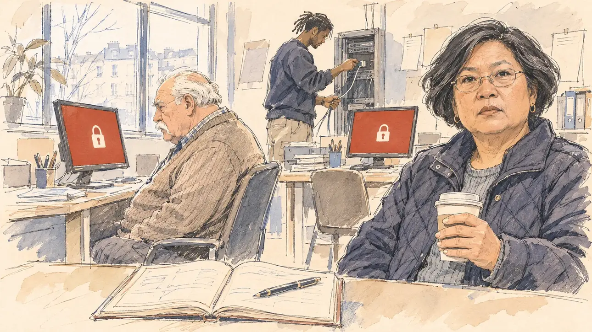

# `ransomware` · Le QG rançonné

**Validée par le PO le 10/11/2026**, au deuxième essai, avec un prompt revu dans une nouvelle conversation. Elle sert telle quelle en clair et en sombre.



| Champ | Valeur |
| --- | --- |
| Carte | `ransomware`, catégorie `team` (Crise d'équipe), poids 0,2, toute semaine |
| Style | Reportage dessiné |
| Ton | Tendu, matin froid |
| Date | 2026-11-10 |
| Outil | ChatGPT Images, à compléter (modèle et effort) |
| Conversation | À compléter |
| Format rendu | 1672 × 941 (16:9) : export en 1290 × 726 px, WebP de qualité 75, 159 Ko, sans recadrage, fait depuis la copie WebP de la conversation (à refaire depuis le PNG d'origine) |
| Fichier d'origine | À compléter (hors du dépôt) |
| Première édition | À compléter |

## Texte de la carte

> **Le QG rançonné**
>
> Un logiciel malveillant bloque les ordinateurs de votre QG et le fichier de votre base militante. Les pirates réclament une rançon pour les libérer.

## Le moment choisi

Le QG de campagne, en terrain neutre, un matin clair de février, à l'arrivée de l'équipe : les écrans affichent le même cadenas blanc sur fond rouge brique, sans texte ni tête de mort. Le candidat reste hors champ : l'agenda papier de la journée, ouvert avec son stylo, désormais la seule chose qui marche. La responsable du QG, gobelet de café en main, regarde le spectateur : tout est bloqué. Le vieux militant fixe le cadenas sur son écran, tourné vers lui ; un jeune bénévole débranche la baie de serveurs. [`leakedMails`](../attack/leakedMails.md) se passe la nuit, en cellule de crise ; celle-ci le matin, dans la stupeur.

## Prompt complet

Dans une nouvelle conversation, avec [`primeTime.webp`](../../illustrations/media/primeTime.webp) comme seule image de référence. Le prompt revu après le premier essai : l'écran du vieux militant tourné vers lui et vu de trois quarts, trois ou quatre écrans au lieu d'un sur chaque bureau, et les contraintes contre le grain craquelé et les contours en pointillés.

```
Use the attached image as the style reference and copy its drawing: a realistic reportage drawing made on the spot for a newspaper, with quick, nervous pencil lines, often drawn twice, ink hatching in the shadows, transparent watercolour washes that spill a little over the lines, and the warm paper showing through. Not the same scene and not the same people: never reuse the face or the hair of the woman in the reference.
Like in the reference, the setting can be full when the story needs it, with the things that say where we are and what is happening, but each one is sketched with a few pencil lines and a light wash, never rendered or finished, and the drawing gets looser and paler towards the edges until it fades into the bare paper.
This must look like a drawing made by hand on paper by a press illustrator, halfway between a quick sketch and a realistic picture: never a photograph, a film poster or a digital painting, and never a cartoon, a comic strip, a caricature or a children's book illustration. Continuous lines, never dotted or dashed outlines; no uniform texture, speckles or hatching filter laid over the picture; no glossy highlights, no smooth gradients, in the sky and on the walls too. Colour can be rich in places, on a piece of clothing, a light or a flag, but it stays transparent and within the palette below. The fade into the paper at the edges stays narrow, without a wide white margin. No blur and no depth-of-field effect: everything, the foreground included, is drawn sharp, like a sketch made on the spot.
People are drawn from life with realistic anatomy and proportions, like in the reference: faces shaped with pencil lines, hatching and light washes, a little more finished than the background but never photographic (no photographic skin, no airbrushed or digital-painting look). Expressions stay natural and restrained, even in laughter or tears: no exaggerated grins, no wide-open mouths full of teeth, no rubbery or cartoonish faces.

Editorial illustration, landscape 16:9 (1536 × 864 px), the scene filling the frame, with only a light fade into the paper at the edges. The player's campaign headquarters in an ordinary French city, on a bright morning in February 2027, at the moment the team arrives and finds that malicious software has locked the computers and the file of the campaign's activists: a few desks, and on the three or four monitors in the room the same flat brick-red screen with a simple white padlock pictogram, no text and no skull; morning light through a large window with no recognisable city. The player's candidate stays off-camera: in the foreground, only the paper diary of the day's meetings, open on a desk with a pen, now the only thing that still works. In the right third, the headquarters manager, a round woman in her fifties of Cambodian descent, with a short layered bob, thin glasses and a quilted jacket, holds a paper cup of coffee and looks at the viewer, stunned and grave, everything is locked, her face above mid-height. Behind her, an old activist, a heavy-set white man in his seventies with a white moustache and a cardigan, sits at his desk in three-quarter view, facing his own monitor, which is turned towards him and seen at an angle so that its red padlock screen is visible to the viewer too; he stares at it, his hands off the keyboard. No monitor is seen from the back in the foreground. At the back, a young IT volunteer, a tall Black man in his twenties with short locs and a sweatshirt, unplugs the cables of a small server rack. Only the manager looks at the viewer. Nothing on the screens, the diary, the rack or the walls is readable.

Style: Reportage drawing made on the spot, like a press illustrator or courtroom sketch artist: pencil and ink with loose watercolour washes, lively unfinished lines, white paper showing through.

Palette: navy #13203F, vellum #F5EFE1, gold #A9802A, brick #B5523B, ochre #D9A441, sage #8FA58A, slate #5E7186, sand #DCC8A4, warm grey #8C8279; use 4 to 6 of them, subtle warm paper grain.

Tone: tense, bright cold morning light, the few brick-red screens as the strongest colour of the picture.

Constraints: realistic proportions, natural expressions, never cartoonish or caricatured faces, drawn like the rest of the illustration and never photographic; people of varied ages, genders, origins and body types (heavy, stocky, round, tall, short, wiry, not only slim), each with a distinct face and haircut (no two people alike), drawn with respect and never as a joke; each person's age, build and look plausible for their job and the scene (working people of working age), no stereotype tying an origin or a gender to a role, and no person of colour shown alone in a featured service or deferential role; anatomically correct hands with exactly five fingers, few hands visible, the others in pockets, behind objects or out of frame; no readable text anywhere (the screens, the diary, the rack and the walls stay unreadable, no ransom note, no numbers); no captions or speech bubbles; no logos, no political party colours; no hooded hacker cliché, no skulls or code rain on the screens; no recognisable real person, no lookalike of a real politician; no explicit violence; no photographic rendering, no blur or bokeh, every outline a continuous pencil or ink line with no dotted or dashed outlines, no mottled, crackled or speckled texture over the faces, the clothes, the desks or the walls, no hatching filter over the picture, no oil-paint texture, no glow or halo around the screens, no wide white margin or frame (a light fade into the paper at the edges is fine).

Format: if 16:9 is not available, make 1536 × 1024 and keep the top 80 px and the bottom 80 px free of anything important (faces, hands, the main action): they will be cropped.
```

## Décisions prises sur cette image

Validée telle quelle par le PO (10/11/2026). Sous l'écran de gauche, quelques signes minuscules peuvent évoquer une marque : illisibles, invisibles à la taille de la carte, gardés. Une plante, esquissée, est restée à gauche.

## Essais écartés

1. **Premier essai** (une première version du prompt, avec un écran sur chaque bureau, que le PO avait adaptée) : la scène était juste, mais un grain craquelé uniforme couvrait toute l'image, des taches blanches parsemaient la doudoune, les contours des objets étaient souvent en pointillés, et l'écran du vieux militant était vu de dos. Le PO a demandé le prompt revu ci-dessus, dans une nouvelle conversation, plutôt qu'un message de correction.

## Retouches

Aucune.

## Relecture

Faite et validée par le PO le 10/11/2026.

- [x] Aucun texte lisible : les écrans ne portent que le cadenas, l'agenda que des traits ; aucune demande de rançon, aucun chiffre.
- [x] Aucun sosie d'une personne réelle ; aucun cliché de pirate.
- [x] Le candidat du joueur est hors champ : seuls son agenda et son stylo, au premier plan.
- [x] Mains et visages sans défaut visible à 343 px de large : la main au gobelet, celles du bénévole sur les câbles.
- [x] Aucune couleur ni aucun logo de parti. Des personnes variées par l'âge, le corps, l'origine et la coiffure.
- [x] En 16:9 : pas de recadrage.
- [ ] Lisible sur la page de l'événement, en clair et en sombre : à vérifier dans l'app, une fois la carte publiée.
