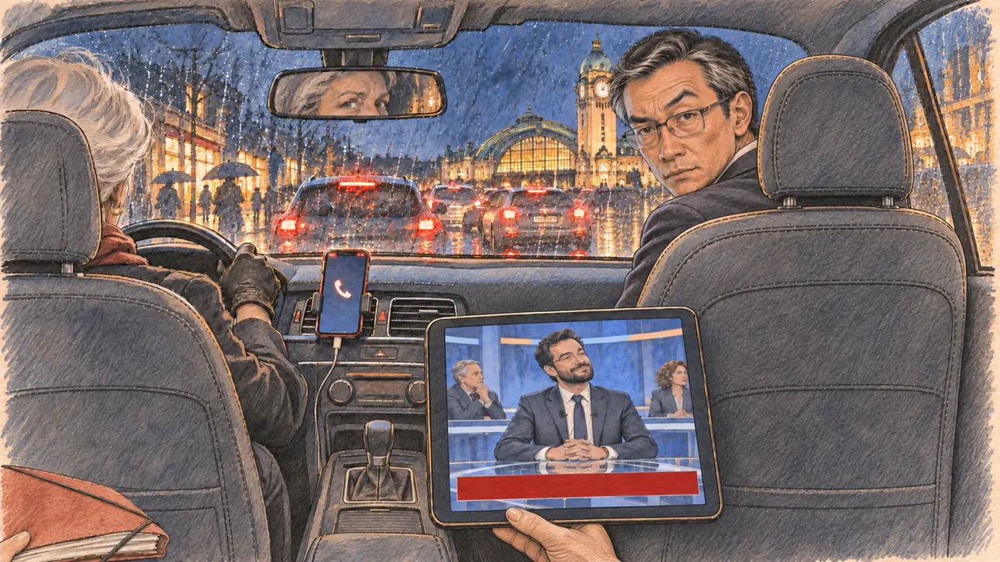

# `spokespersonContradicts` · Votre porte-parole vous contredit en direct

**À générer.** Prompt prêt le 05/11/2026, pas encore d'image validée.



| Champ | Valeur |
| --- | --- |
| Carte | `spokespersonContradicts`, catégorie `team` (Crise d'équipe), carte ajoutée par la PR #297 de l'app |
| Style | Reportage dessiné, trait de `primeTime` |
| Ton | Tendu et ironique |
| Date | À remplir |
| Outil | ChatGPT Images |
| Conversation | À remplir (le lien ne s'ouvre qu'avec le compte qui l'a créée) |
| Format rendu | À remplir |
| Fichier d'origine | À remplir |
| Première édition | À remplir |

## Texte de la carte

> **Votre porte-parole vous contredit en direct**
>
> En direct sur une chaîne d'information, votre porte-parole nuance publiquement une de vos positions, puis ajoute que « le débat reste ouvert au sein de la campagne ». Les commentateurs s'emballent.

## Le moment choisi

La banquette arrière de la voiture de campagne, coincée dans les embouteillages de Limoges un soir de pluie, vue depuis la place du candidat (hors champ) : au premier plan, le dossier d'un discours posé sur la banquette et une ceinture de sécurité. Le directeur de cabinet, sur le siège passager, se retourne et tend au candidat une tablette où passe le direct : le porte-parole sur le plateau d'une chaîne d'information, souriant, sous un bandeau sans mots. La conductrice jette un coup d'œil dans le rétroviseur. Par les vitres mouillées : les feux des voitures, les vitrines, et la tour de l'horloge de la gare des Bénédictins illuminée.

## Prompt complet

Dans une nouvelle conversation, avec [`primeTime.webp`](../../illustrations/media/primeTime.webp) comme seule image de référence.

```
Use the attached image as the style reference and copy its drawing: a realistic reportage drawing made on the spot for a newspaper, with quick, nervous pencil lines, often drawn twice, ink hatching in the shadows, transparent watercolour washes that spill a little over the lines, and the warm paper showing through. Not the same scene and not the same people: never reuse the face or the hair of the woman in the reference.
Like in the reference, the setting can be full when the story needs it, with the things that say where we are and what is happening, but each one is sketched with a few pencil lines and a light wash, never rendered or finished, and the drawing gets looser and paler towards the edges until it fades into the bare paper.
This must look like a drawing made by hand on paper by a press illustrator, halfway between a quick sketch and a realistic picture: never a photograph, a film poster or a digital painting, and never a cartoon, a comic strip, a caricature or a children's book illustration. Continuous lines, never dotted or dashed outlines; no uniform texture, speckles or hatching filter laid over the picture; no glossy highlights, no smooth gradients, in the sky and on the walls too. Colour can be rich in places, on a piece of clothing, a light or a flag, but it stays transparent and within the palette below. The fade into the paper at the edges stays narrow, without a wide white margin. No blur and no depth-of-field effect: everything, the foreground included, is drawn sharp, like a sketch made on the spot.
People are drawn from life with realistic anatomy and proportions, like in the reference: faces shaped with pencil lines, hatching and light washes, a little more finished than the background but never photographic (no photographic skin, no airbrushed or digital-painting look). Expressions stay natural and restrained, even in laughter or tears: no exaggerated grins, no wide-open mouths full of teeth, no rubbery or cartoonish faces.

Editorial illustration, landscape 16:9 (1536 × 864 px), the scene filling the frame, with only a light fade into the paper at the edges. The back seat of the campaign car stuck in traffic in Limoges, in the Limousin, on a rainy evening in early 2027: live on a news channel, the player's candidate's spokesperson publicly qualifies one of the candidate's positions, then adds that the debate remains open within the campaign, and the commentators get carried away. The scene is seen from the candidate's seat at the back of the car, who stays off-camera: in the foreground, only a folder with a speech lying on the back seat and the buckle of a seat belt. In the right third, the chief of staff, a man in his fifties of Chinese origin, slim, with grey temples, rectangular glasses and a loosened tie, has turned round from the front passenger seat and holds out a tablet towards the viewer with an exasperated, incredulous look, one eyebrow raised, his face above mid-height. On the tablet: the live broadcast of a news channel set, the spokesperson, a man in his thirties with a neat beard and a slim suit, speaking with a calm, self-satisfied smile at a glass desk, under a red news banner with no words; nothing on the tablet shows the candidate. Around them, sketched in pencil and light washes: the driver, a woman in her sixties with short white hair and leather gloves, glancing at the viewer in the rear-view mirror, her eyes alone visible in it; the dashboard with a phone in a holder showing only a missed-calls icon; on the window, raindrops, and outside the red tail lights of the cars in the traffic jam, the lit shop windows, people under umbrellas, and the tall lit clock tower of the Limoges-Bénédictins railway station with its copper dome, against the dark blue rainy sky. Only the chief of staff looks straight at the viewer. Nothing on the tablet, the banner, the phone, the folder or the shop windows is readable, and no logo of a real TV channel, car brand or company appears.

Style: Reportage drawing made on the spot, like a press illustrator or courtroom sketch artist: pencil and ink with loose watercolour washes, lively unfinished lines, white paper showing through.

Palette: navy #13203F, vellum #F5EFE1, gold #A9802A, brick #B5523B, ochre #D9A441, sage #8FA58A, slate #5E7186, sand #DCC8A4, warm grey #8C8279; use 4 to 6 of them, subtle warm paper grain.

Tone: tense and ironic, the cold blue glow of the tablet in the dark car, the red tail lights and the reflections of the rain on the windows, and the warm lit clock tower of the station outside.

Constraints: realistic proportions, natural expressions, never cartoonish or caricatured faces, drawn like the rest of the illustration and never photographic; people of varied ages, genders, origins and body types (heavy, stocky, round, tall, short, wiry, not only slim), each with a distinct face and haircut (no two people alike), drawn with respect and never as a joke; anatomically correct hands with exactly five fingers, few hands visible, the others in pockets, behind objects or out of frame; no readable text anywhere (the tablet, the banner, the phone, the folder and the shop windows stay unreadable); no captions or speech bubbles; no logos or political party colours; no recognisable real person, no lookalike of a real politician, and no logo of a real TV channel, car brand or company; no explicit violence; no photographic rendering, no blur or bokeh, no dotted outlines, no texture or hatching filter over the picture, no oil-paint texture, no wide white margin or frame (a light fade into the paper at the edges is fine).

Format: if 16:9 is not available, make 1536 × 1024 and keep the top 80 px and the bottom 80 px free of anything important (faces, hands, the main action): they will be cropped.
```

## Décisions prises sur cette image

Aucune pour l'instant.

## Essais écartés

Aucun pour l'instant.

## Retouches

Aucune.

## Relecture

À faire sur l'image validée.
