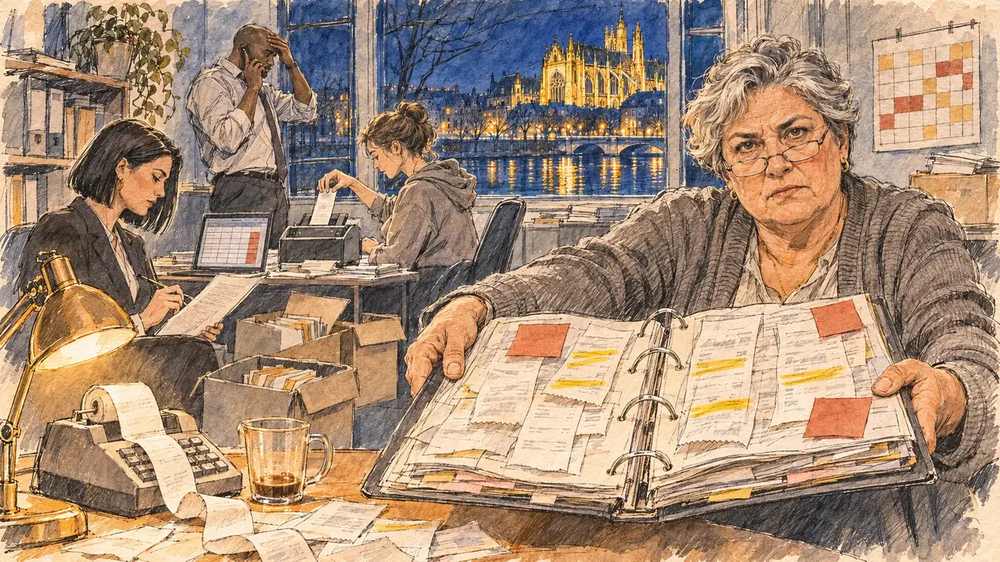

# `treasurerGap` · Un trou dans les comptes

**Validée par le PO le 05/11/2026**, au premier essai, avec `primeTime.webp` comme référence. Elle sert telle quelle en clair et en sombre.



| Champ | Valeur |
| --- | --- |
| Carte | `treasurerGap`, catégorie `team` (Crise d'équipe), carte ajoutée par la PR #297 de l'app |
| Style | Reportage dessiné, trait de `primeTime` |
| Ton | Tendu |
| Date | 2026-11-05 |
| Outil | ChatGPT Images |
| Conversation | À remplir (le lien ne s'ouvre qu'avec le compte qui l'a créée) |
| Format rendu | 1672 × 941 (16:9) : export en 1290 × 726 px, WebP de qualité 75, 256 Ko, sans recadrage |
| Fichier d'origine | Image de ChatGPT, chez le PO. L'export du dépôt a été fait depuis la copie partagée dans la conversation avec Claude |
| Première édition | La prochaine Release qui suit le merge de la PR #297 de l'app |

## Texte de la carte

> **Un trou dans les comptes**
>
> Votre trésorerie découvre 30 000 euros de dépenses sans justificatif dans les comptes de campagne. Personne ne sait encore qui a signé quoi.

## Le moment choisi

Le bureau du trésorier au QG de campagne à Metz, tard un soir d'hiver, vu depuis la porte où le candidat (hors champ) vient d'entrer : au premier plan, le coin d'un bureau couvert de reçus, une calculatrice à rouleau et une tasse froide. La trésorière, lunettes en demi-lune, tend au candidat un classeur ouvert sur des lignes surlignées et des notes autocollantes. Autour : les boîtes d'archives ouvertes, un ordinateur avec un tableau aux cases rouges, le directeur de campagne au téléphone, un jeune bénévole qui scanne des reçus, une avocate qui relit un contrat. Par la fenêtre : la Moselle la nuit et la cathédrale Saint-Étienne illuminée, en pierre jaune de Jaumont.

## Prompt complet

Dans une nouvelle conversation, avec [`primeTime.webp`](../../illustrations/media/primeTime.webp) comme seule image de référence.

```
Use the attached image as the style reference and copy its drawing: a realistic reportage drawing made on the spot for a newspaper, with quick, nervous pencil lines, often drawn twice, ink hatching in the shadows, transparent watercolour washes that spill a little over the lines, and the warm paper showing through. Not the same scene and not the same people: never reuse the face or the hair of the woman in the reference.
Like in the reference, the setting can be full when the story needs it, with the things that say where we are and what is happening, but each one is sketched with a few pencil lines and a light wash, never rendered or finished, and the drawing gets looser and paler towards the edges until it fades into the bare paper.
This must look like a drawing made by hand on paper by a press illustrator, halfway between a quick sketch and a realistic picture: never a photograph, a film poster or a digital painting, and never a cartoon, a comic strip, a caricature or a children's book illustration. Continuous lines, never dotted or dashed outlines; no uniform texture, speckles or hatching filter laid over the picture; no glossy highlights, no smooth gradients, in the sky and on the walls too. Colour can be rich in places, on a piece of clothing, a light or a flag, but it stays transparent and within the palette below. The fade into the paper at the edges stays narrow, without a wide white margin. No blur and no depth-of-field effect: everything, the foreground included, is drawn sharp, like a sketch made on the spot.
People are drawn from life with realistic anatomy and proportions, like in the reference: faces shaped with pencil lines, hatching and light washes, a little more finished than the background but never photographic (no photographic skin, no airbrushed or digital-painting look). Expressions stay natural and restrained, even in laughter or tears: no exaggerated grins, no wide-open mouths full of teeth, no rubbery or cartoonish faces.

Editorial illustration, landscape 16:9 (1536 × 864 px), the scene filling the frame, with only a light fade into the paper at the edges. The treasurer's small office in the campaign headquarters of the player's candidate in Metz, in Lorraine, late on a winter evening in early 2027: the treasurer has found 30,000 euros of campaign expenses with no receipt in the campaign accounts, and nobody knows yet who signed what. The scene is seen from the door where the candidate has just come in, who stays off-camera: in the foreground, only the corner of a desk covered with receipts, an adding machine with its paper roll spilling out, and a cold cup of coffee. In the right third, the campaign treasurer, a woman in her late fifties of Italian origin, a retired bank clerk, sturdy and round, with short silver hair, half-moon reading glasses on the tip of her nose and a grey cardigan, holds out towards the viewer a thick open binder of receipts with lines highlighted in yellow and red sticky notes, with a grave, worried, demanding look, her face above mid-height. Around her, sketched in pencil and light washes: open archive boxes piled on the floor; a laptop showing a spreadsheet with a column of red cells; the campaign director, a tall man in his forties of Cameroonian origin with a shaved head and a loosened tie, on the phone by the window with his free hand on his forehead; a young volunteer with a bun and a hoodie scanning receipts one by one at a small scanner; a lawyer in her thirties with a sleek black bob and a dark suit, reading a contract with a pen in her hand; a wall calendar with only coloured squares; a desk lamp throwing a warm circle of light on the papers. Through the window, Metz at night: the Moselle with its lights on the water, and the tall Gothic cathedral of Saint-Étienne, lit up, its yellow Jaumont stone glowing gold against the dark blue sky. Only the treasurer looks straight at the viewer. Nothing on the receipts, the binder, the sticky notes, the spreadsheet, the contract, the boxes or the calendar is readable, and no logo of a real bank or company appears.

Style: Reportage drawing made on the spot, like a press illustrator or courtroom sketch artist: pencil and ink with loose watercolour washes, lively unfinished lines, white paper showing through.

Palette: navy #13203F, vellum #F5EFE1, gold #A9802A, brick #B5523B, ochre #D9A441, sage #8FA58A, slate #5E7186, sand #DCC8A4, warm grey #8C8279; use 4 to 6 of them, subtle warm paper grain.

Tone: tense, the warm circle of the desk lamp on the papers in the dark office, the red cells and sticky notes as the alarm, and the golden stone of the cathedral through the window.

Constraints: realistic proportions, natural expressions, never cartoonish or caricatured faces, drawn like the rest of the illustration and never photographic; people of varied ages, genders, origins and body types (heavy, stocky, round, tall, short, wiry, not only slim), each with a distinct face and haircut (no two people alike), drawn with respect and never as a joke; anatomically correct hands with exactly five fingers, few hands visible, the others in pockets, behind objects or out of frame; no readable text anywhere (the receipts, the binder, the sticky notes, the spreadsheet, the contract, the boxes and the calendar stay unreadable); no captions or speech bubbles; no logos or political party colours; no recognisable real person, no lookalike of a real politician, and no logo of a real bank or company; no explicit violence; no photographic rendering, no blur or bokeh, no dotted outlines, no texture or hatching filter over the picture, no oil-paint texture, no wide white margin or frame (a light fade into the paper at the edges is fine).

Format: if 16:9 is not available, make 1536 × 1024 and keep the top 80 px and the bottom 80 px free of anything important (faces, hands, the main action): they will be cropped.
```

## Décisions prises sur cette image

Aucune.

## Essais écartés

Aucun.

## Retouches

Aucune.

## Relecture

Faite et validée par le PO le 05/11/2026.

- [x] Aucun texte lisible : les reçus et le tableur n'ont que des lignes grises, des surlignages et des cases de couleur ; rien n'est lisible sur le classeur, le contrat, les boîtes ni le calendrier.
- [x] Aucun sosie d'une personne réelle.
- [x] Le candidat du joueur est hors champ.
- [x] Mains, visages et foules sans défaut visible à 343 px de large.
- [x] Aucune couleur ni aucun logo de parti. Des personnes variées par l'âge, le corps, l'origine et la coiffure.
- [x] En 3:2 : sans objet, l'image est en 16:9.
- [x] Lisible sur la page de l'événement, en clair et en sombre.

Ce que la relecture a accepté : la trésorière tient le classeur des deux mains, ouvert vers le spectateur ; la calculatrice à rouleau est une machine de bureau ancienne.
