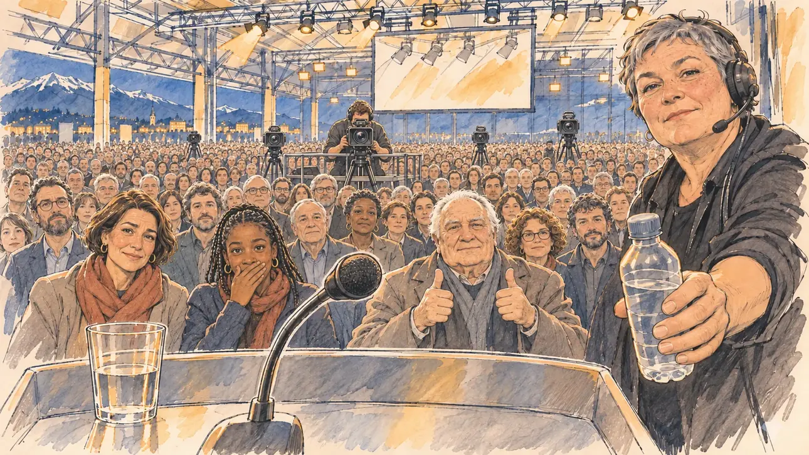

# `crackingVoice` · La voix qui lâche

**Retenue par le PO le 15/11/2026**, au premier essai. Elle sert telle quelle en clair et en sombre.



| Champ | Valeur |
| --- | --- |
| Carte | `crackingVoice`, catégorie `touringIncident` (Contretemps de tournée), poids 0,12, toute semaine ; une leçon de la campagne (charisme +2 sur la réponse du coach), une seule des six par partie (Mitchnsun/moi-president, PO, 14/11/2026) |
| Style | Reportage dessiné |
| Ton | Ironique en douceur, projecteurs dorés |
| Date | 2026-11-15 |
| Outil | ChatGPT Images, modèle GPT 6.2, effort Light |
| Format rendu | 1672 × 941 (16:9) : export en 1290 × 726 px, WebP de qualité 75, 192 Ko, sans recadrage, fait depuis la copie WebP de la conversation |
| Fichier d'origine | Image de ChatGPT, chez le PO. L'export du dépôt a été fait depuis la copie partagée dans la conversation avec Claude |
| Première édition | `kit-france-2611-0004` |

## Texte de la carte

> **La voix qui lâche**
>
> En plein meeting, votre voix part dans les aigus au moment de la phrase la plus attendue. Quatre mille personnes l'ont entendue, et les chaînes d'info aussi.

## Le moment choisi

Un grand meeting dans un hall d'exposition de Grenoble, un soir de février, une seconde après que la voix a déraillé : une salle comble, les projecteurs, les praticables des caméras, un grand écran sans image du candidat, et par les baies vitrées les Alpes enneigées et les lumières de la ville. Le candidat est au pupitre, hors champ : seuls le pupitre, son micro et un verre d'eau. En coulisse, la régisseuse lui tend une bouteille d'eau : respirez, ça va aller. Au premier rang, un militant âgé lève les deux pouces, une adolescente retient un fou rire, une militante grimace de compassion ; un cadreur zoome. Le précédent est le « C'est notre projet » d'un candidat de 2017, qui a ensuite travaillé sa voix avec un baryton : personne n'y ressemble à un responsable politique.

## Prompt complet

Dans une nouvelle conversation, avec [`primeTime.webp`](../../illustrations/media/primeTime.webp) comme seule image de référence :

```
Use the attached image as the style reference and copy its drawing: a realistic reportage drawing made on the spot for a newspaper, with quick, nervous pencil lines, often drawn twice, ink hatching in the shadows, transparent watercolour washes that spill a little over the lines, and the warm paper showing through. Not the same scene and not the same people: never reuse the face or the hair of the woman in the reference.
Like in the reference, the setting can be full when the story needs it, with the things that say where we are and what is happening, but each one is sketched with a few pencil lines and a light wash, never rendered or finished, and the drawing gets looser and paler towards the edges until it fades into the bare paper.
This must look like a drawing made by hand on paper by a press illustrator, halfway between a quick sketch and a realistic picture: never a photograph, a film poster or a digital painting, and never a cartoon, a comic strip, a caricature or a children's book illustration. Continuous lines, never dotted or dashed outlines; no uniform texture, speckles or hatching filter laid over the picture; no glossy highlights, no smooth gradients, in the sky and on the walls too. Colour can be rich in places, on a piece of clothing, a light or a flag, but it stays transparent and within the palette below. The fade into the paper at the edges stays narrow, without a wide white margin. No blur and no depth-of-field effect: everything, the foreground included, is drawn sharp, like a sketch made on the spot.
People are drawn from life with realistic anatomy and proportions, like in the reference: faces shaped with pencil lines, hatching and light washes, a little more finished than the background but never photographic (no photographic skin, no airbrushed or digital-painting look). Expressions stay natural and restrained, even in laughter or tears: no exaggerated grins, no wide-open mouths full of teeth, no rubbery or cartoonish faces.

Editorial illustration, landscape 16:9 (1536 × 864 px), the scene filling the frame, with only a light fade into the paper at the edges. A big campaign rally in an exhibition hall in Grenoble, on an evening in February 2027, a second after the player's candidate's voice cracked on the most awaited line: a packed hall, thousands of people standing, stage lights, television camera risers in the middle of the crowd, a large screen showing only the lights of the stage. The player's candidate stands at the lectern and stays off-camera: in the foreground, only the lectern, its microphone and a half-full glass of water. In the right third, in the wings at the edge of the stage, the stage manager, a stocky woman in her forties of Breton origin with short grey hair, a headset on, dressed all in black, holds out a bottle of water towards the viewer with a small encouraging nod, as if saying breathe, it will be fine, her face above mid-height. In the front row: a heavy-set elderly supporter with white hair gives two thumbs up; a teenage girl of Haitian descent with braids holds back a fit of giggles behind her hand; a supporter in her thirties of Algerian descent with a short bob winces with sympathy. On a riser, a camera operator zooms in. Only the stage manager and the elderly supporter look at the viewer. Nothing on the screen, the lectern, the cameras, the badges or the clothes is readable.

Style: Reportage drawing made on the spot, like a press illustrator or courtroom sketch artist: pencil and ink with loose watercolour washes, lively unfinished lines, white paper showing through.

Palette: navy #13203F, vellum #F5EFE1, gold #A9802A, brick #B5523B, ochre #D9A441, sage #8FA58A, slate #5E7186, sand #DCC8A4, warm grey #8C8279; use 4 to 6 of them, subtle warm paper grain.

Tone: gently ironic, postures slightly exaggerated but never the faces, the golden warmth of the stage lights on the crowd, a suspended moment right after the slip.

Constraints: realistic proportions, natural expressions, never cartoonish or caricatured faces, drawn like the rest of the illustration and never photographic; people of varied ages, genders, origins and body types (heavy, stocky, round, tall, short, wiry, not only slim), each with a distinct face and haircut (no two people alike), drawn with respect and never as a joke; each person's age, build and look plausible for their job and the scene (working people of working age), no stereotype tying an origin or a gender to a role, and no person of colour shown alone in a featured service or deferential role; anatomically correct hands with exactly five fingers, few hands visible, the others in pockets, behind objects or out of frame; no readable text anywhere (the screen, the lectern, the cameras, the badges and the clothes stay unreadable, no slogans, no banners with words); no captions or speech bubbles; no logos, no television channel logo, no political party colours or flags in the crowd, no campaign signs with words; no recognisable real person, no lookalike of a real politician; no image of the candidate on the screen; no explicit violence; no photographic rendering, no blur or bokeh, every outline a continuous pencil or ink line with no dotted or dashed outlines, no mottled, crackled or speckled texture over the faces, the clothes or the hall, no hatching filter over the picture, no oil-paint texture, no glow, halo or lens flare around the stage lights, no wide white margin or frame (a light fade into the paper at the edges is fine).

Format: if 16:9 is not available, make 1536 × 1024 and keep the top 80 px and the bottom 80 px free of anything important (faces, hands, the main action): they will be cropped.
```

## Décisions prises sur cette image

Retenue telle quelle par le PO (15/11/2026). Le premier rang et une bonne part de la foule regardent le spectateur, plus que les deux personnages demandés : c'est le candidat qu'ils regardent, au pupitre, et la scène y gagne. Les Alpes se voient par les baies vitrées du hall. Le texte de la carte disait « au troisième grand meeting de la semaine » ; le PO l'a changé en « en plein meeting », le jeu n'en permettant qu'un par semaine (15/11/2026).

## Essais écartés

Aucun.

## Retouches

Aucune.

## Relecture

Faite le 15/11/2026, à confirmer par le PO.

- [x] Aucun texte lisible : l'écran ne montre que les lumières ; rien sur le pupitre, les caméras ni les vêtements.
- [x] Aucun sosie d'une personne réelle ; aucune image du candidat sur l'écran.
- [x] Le candidat du joueur est hors champ : seuls son pupitre, son micro et son verre d'eau.
- [x] Mains et visages sans défaut visible à 343 px de large : la main qui tend la bouteille, les deux pouces levés, la main devant la bouche de l'adolescente.
- [x] Aucune couleur, aucun logo ni aucun drapeau de parti dans la salle. Des personnes variées par l'âge, le corps, l'origine et la coiffure.
- [x] En 16:9 : pas de recadrage.
- [ ] Lisible sur la page de l'événement, en clair et en sombre : à vérifier dans l'app, une fois la carte publiée.
