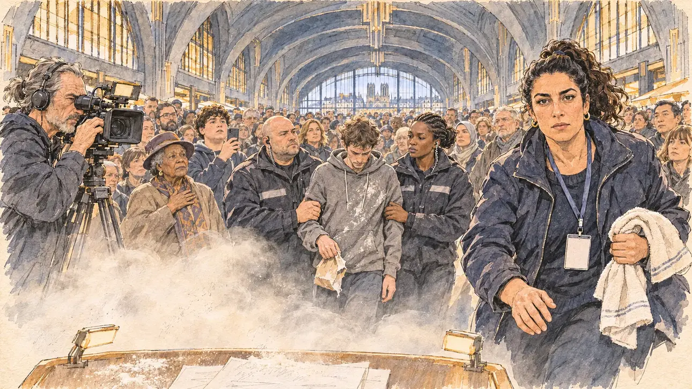

# `flourAttack` · Un sac de farine

**Validée par le PO le 08/11/2026**, au deuxième essai, après un message de correction du rendu dans la même conversation. Elle sert telle quelle en clair et en sombre.



| Champ | Valeur |
| --- | --- |
| Carte | `flourAttack`, catégorie `touringIncident` (Contretemps de tournée), poids 0,2 (0,35 dans les deux premiers du sondage) |
| Style | Reportage dessiné |
| Ton | Tendu, un instant figé |
| Date | 2026-11-08 |
| Outil | ChatGPT Images, à compléter (modèle et effort) |
| Conversation | À compléter |
| Format rendu | 1672 × 941 (16:9) : export en 1290 × 726 px, WebP de qualité 75, 203 Ko, sans recadrage, fait depuis la copie WebP de la conversation (à refaire depuis le PNG d'origine) |
| Fichier d'origine | À compléter (hors du dépôt) |
| Première édition | À compléter |

## Texte de la carte

> **Un sac de farine**
>
> Vous montez sur scène quand un homme surgit du public et vous lance un sachet de farine au visage. La salle se fige, les caméras tournent.

## Le moment choisi

L'instant qui suit le jet, sous les voûtes Art déco en béton des halles du Boulingrin, à Reims, vu depuis la scène. Le candidat reste hors champ : le bord de son pupitre et les pages de son discours, enfarinées, avec le nuage de farine qui retombe. Une collaboratrice de la campagne accourt avec une serviette et regarde le spectateur, inquiète mais calme ; deux agents de sécurité emmènent le lanceur par le bras, sans brutalité ; un caméraman filme ; la salle est figée. Reims n'avait encore servi à aucune carte.

## Prompt complet

Dans une nouvelle conversation, avec [`primeTime.webp`](../../illustrations/media/primeTime.webp) comme seule image de référence :

```
Use the attached image as the style reference and copy its drawing: a realistic reportage drawing made on the spot for a newspaper, with quick, nervous pencil lines, often drawn twice, ink hatching in the shadows, transparent watercolour washes that spill a little over the lines, and the warm paper showing through. Not the same scene and not the same people: never reuse the face or the hair of the woman in the reference.
Like in the reference, the setting can be full when the story needs it, with the things that say where we are and what is happening, but each one is sketched with a few pencil lines and a light wash, never rendered or finished, and the drawing gets looser and paler towards the edges until it fades into the bare paper.
This must look like a drawing made by hand on paper by a press illustrator, halfway between a quick sketch and a realistic picture: never a photograph, a film poster or a digital painting, and never a cartoon, a comic strip, a caricature or a children's book illustration. Continuous lines, never dotted or dashed outlines; no uniform texture, speckles or hatching filter laid over the picture; no glossy highlights, no smooth gradients, in the sky and on the walls too. Colour can be rich in places, on a piece of clothing, a light or a flag, but it stays transparent and within the palette below. The fade into the paper at the edges stays narrow, without a wide white margin. No blur and no depth-of-field effect: everything, the foreground included, is drawn sharp, like a sketch made on the spot.
People are drawn from life with realistic anatomy and proportions, like in the reference: faces shaped with pencil lines, hatching and light washes, a little more finished than the background but never photographic (no photographic skin, no airbrushed or digital-painting look). Expressions stay natural and restrained, even in laughter or tears: no exaggerated grins, no wide-open mouths full of teeth, no rubbery or cartoonish faces.

Editorial illustration, landscape 16:9 (1536 × 864 px), the scene filling the frame, with only a light fade into the paper at the edges. A campaign rally in 2027 under the high Art Deco concrete vaults of a covered market hall in Reims, seen from the stage, at the very instant after a bag of flour has been thrown: a white cloud of flour still drifts down in the warm stage light. The player's candidate stays off-camera: in the foreground, only the edge of a lectern and a few pages of the speech, dusted with flour. In the right third, a campaign aide in her thirties of Moroccan descent, stocky, with a high ponytail and a blank lanyard badge, hurries towards the viewer with a folded towel and looks at the viewer, worried but composed, her face above mid-height. Below the stage, two security stewards in black jackets calmly lead the flour thrower away by the arms, without any violence: a heavy-set white steward in his forties with a shaved head, and a tall Black steward in her thirties with braids tied back; the thrower, a thin white man in his twenties in a grey hoodie, looks at the floor, a torn paper bag still in one hand. On the left, a TV camera operator, a wiry man in his fifties with a grey ponytail, keeps filming the stage. The crowd beyond is frozen: an elderly woman of Caribbean descent in a felt hat holds her hand to her chest, a round teenage boy with curly hair lifts his phone, others stand still, sketched into the distance under the vaults. Nobody laughs. Only the aide looks at the viewer. Nothing on the badges, the stewards' jackets, the phones, the camera or the backdrop is readable.

Style: Reportage drawing made on the spot, like a press illustrator or courtroom sketch artist: pencil and ink with loose watercolour washes, lively unfinished lines, white paper showing through.

Palette: navy #13203F, vellum #F5EFE1, gold #A9802A, brick #B5523B, ochre #D9A441, sage #8FA58A, slate #5E7186, sand #DCC8A4, warm grey #8C8279; use 4 to 6 of them, subtle warm paper grain.

Tone: tense, a frozen instant, warm golden stage light against the white cloud of flour and the cool grey of the concrete vaults.

Constraints: realistic proportions, natural expressions, never cartoonish or caricatured faces, drawn like the rest of the illustration and never photographic; people of varied ages, genders, origins and body types (heavy, stocky, round, tall, short, wiry, not only slim), each with a distinct face and haircut (no two people alike), drawn with respect and never as a joke; each person's age, build and look plausible for their job and the scene (working people of working age), no stereotype tying an origin or a gender to a role, and no person of colour shown alone in a featured service or deferential role; anatomically correct hands with exactly five fingers, few hands visible, the others in pockets, behind objects or out of frame; no readable text anywhere (the badges, the jackets, the phones, the camera and the backdrop stay unreadable); no captions or speech bubbles; no logos or political party colours; no recognisable real person, no lookalike of a real politician; no explicit violence, nobody hurt, the stewards only hold the thrower's arms; no photographic rendering, no blur or bokeh, no dotted outlines, no texture or hatching filter over the picture, no oil-paint texture, no wide white margin or frame (a light fade into the paper at the edges is fine).

Format: if 16:9 is not available, make 1536 × 1024 and keep the top 80 px and the bottom 80 px free of anything important (faces, hands, the main action): they will be cropped.
```

### Message de correction, dans la même conversation

L'étape 1 de [« Quand le rendu dérive »](../gabarit.md#quand-le-rendu-dérive), avec deux phrases pour la farine et les lumières :

```
Keep the same scene, the same people, the same places and the same poses, but match the rendering of the reference image much more closely: a quick reportage drawing on warm paper, pencil and ink lines, loose watercolour washes, plenty of white paper showing through, lighter and less saturated overall; no photographic rendering, no hatching filter over a finished digital painting; every face is drawn like the clothes, with an ink outline, a few hatching strokes and flat watercolour washes. The flour is a few loose white washes and pencil specks in the air above the lectern and on the pages, not glitter or speckles over the clothes and the crowd. The stage lights and the wall lamps are sketched with a few lines and a pale gold wash: no glow, no halo, no lens flare; the vaults are pencil lines and flat washes, no smooth gradients. Everything else stays the same: nothing readable, exactly five fingers on every visible hand.
```

## Décisions prises sur cette image

Validée par le PO (08/11/2026) après la correction. Le nuage de farine est retombé bas, autour du pupitre, et se lit un peu comme une fumée de scène : gardé, le sweat enfariné du lanceur et la farine sur les pages disent l'incident. La cathédrale de Reims se devine au bout de la halle, une liberté (elle ne se voit pas ainsi depuis les halles).

## Essais écartés

1. **Premier essai** (même conversation) : la scène était juste, mais le rendu avait glissé vers la peinture numérique : visage de la collaboratrice presque photographique avec une texture craquelée posée dessus, la farine en paillettes semées sur les vêtements et la foule, des projecteurs et des appliques à halo, des voûtes en dégradés lisses. Corrigé par le message ci-dessus.

## Retouches

Aucune.

## Relecture

Faite et validée par le PO le 08/11/2026.

- [x] Aucun texte lisible : les pages du discours ne portent que des gribouillis, le badge de la collaboratrice est vierge, rien sur les vestes des agents, les téléphones ni la caméra.
- [x] Aucun sosie d'une personne réelle.
- [x] Le candidat du joueur est hors champ : seul le bord de son pupitre et ses pages enfarinées.
- [x] Mains et visages sans défaut visible à 343 px de large : les deux mains de la collaboratrice (cinq doigts), celles des agents sur les bras du lanceur, la main sur le cœur, le téléphone, la caméra.
- [x] Aucune couleur ni aucun logo de parti. Des personnes variées par l'âge, le corps, l'origine et la coiffure ; deux agents de sécurité, l'un blanc, l'autre noire, côte à côte.
- [x] Aucune violence : les agents tiennent seulement le lanceur par le bras.
- [x] En 16:9 : pas de recadrage.
- [ ] Lisible sur la page de l'événement, en clair et en sombre : à vérifier dans l'app, une fois la carte publiée.
