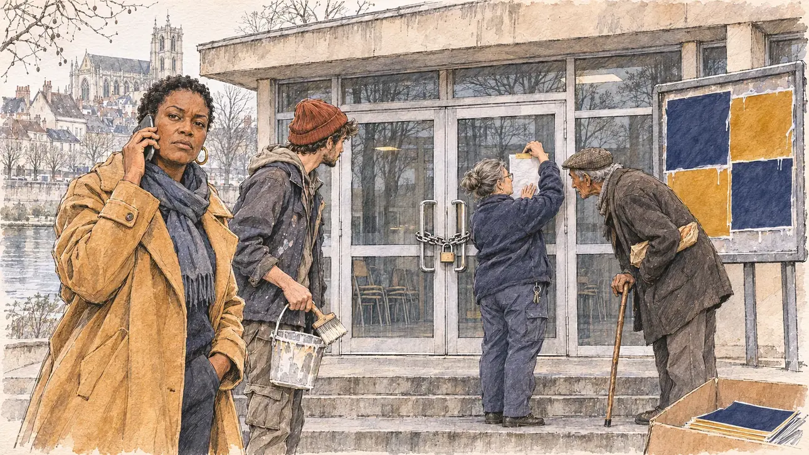

# `hallWithdrawn` · La salle reprise

**Validée par le PO le 08/11/2026**, au premier essai. Elle sert telle quelle en clair et en sombre.



| Champ | Valeur |
| --- | --- |
| Carte | `hallWithdrawn`, catégorie `touringIncident` (Contretemps de tournée), poids 0,2 |
| Style | Reportage dessiné |
| Ton | Tendu mais déterminé |
| Date | 2026-11-08 |
| Outil | ChatGPT Images, à compléter (modèle et effort) |
| Conversation | À compléter |
| Format rendu | 1672 × 941 (16:9) : export en 1290 × 726 px, WebP de qualité 75, 216 Ko, sans recadrage, fait depuis la copie WebP de la conversation (à refaire depuis le PNG d'origine) |
| Fichier d'origine | À compléter (hors du dépôt) |
| Première édition | À compléter |

## Texte de la carte

> **La salle reprise**
>
> À la veille de votre meeting, le maire d'une ville moyenne annule la location de la salle des fêtes « pour raisons d'ordre public ». Votre base militante a déjà collé les affiches.

## Le moment choisi

Le perron d'une salle des fêtes des années 1960 à Auxerre, en Bourgogne, un matin gris de février, la veille du meeting : les portes vitrées sont fermées par une chaîne et un cadenas, et une employée municipale y scotche un avis. Sur le panneau d'à côté, les affiches du meeting sont déjà collées, sans visage ni texte. Le candidat reste hors champ : son carton de tracts du meeting, sur la dernière marche. La responsable locale de la campagne, au téléphone, regarde le spectateur, excédée mais décidée ; un jeune militant tient encore son seau de colle ; un passant âgé lit l'avis. Au fond, de l'autre côté de l'Yonne, la vieille ville et la cathédrale. Auxerre n'avait encore servi à aucune carte.

## Prompt complet

Dans une nouvelle conversation, avec [`primeTime.webp`](../../illustrations/media/primeTime.webp) comme seule image de référence :

```
Use the attached image as the style reference and copy its drawing: a realistic reportage drawing made on the spot for a newspaper, with quick, nervous pencil lines, often drawn twice, ink hatching in the shadows, transparent watercolour washes that spill a little over the lines, and the warm paper showing through. Not the same scene and not the same people: never reuse the face or the hair of the woman in the reference.
Like in the reference, the setting can be full when the story needs it, with the things that say where we are and what is happening, but each one is sketched with a few pencil lines and a light wash, never rendered or finished, and the drawing gets looser and paler towards the edges until it fades into the bare paper.
This must look like a drawing made by hand on paper by a press illustrator, halfway between a quick sketch and a realistic picture: never a photograph, a film poster or a digital painting, and never a cartoon, a comic strip, a caricature or a children's book illustration. Continuous lines, never dotted or dashed outlines; no uniform texture, speckles or hatching filter laid over the picture; no glossy highlights, no smooth gradients, in the sky and on the walls too. Colour can be rich in places, on a piece of clothing, a light or a flag, but it stays transparent and within the palette below. The fade into the paper at the edges stays narrow, without a wide white margin. No blur and no depth-of-field effect: everything, the foreground included, is drawn sharp, like a sketch made on the spot.
People are drawn from life with realistic anatomy and proportions, like in the reference: faces shaped with pencil lines, hatching and light washes, a little more finished than the background but never photographic (no photographic skin, no airbrushed or digital-painting look). Expressions stay natural and restrained, even in laughter or tears: no exaggerated grins, no wide-open mouths full of teeth, no rubbery or cartoonish faces.

Editorial illustration, landscape 16:9 (1536 × 864 px), the scene filling the frame, with only a light fade into the paper at the edges. The steps of a modest 1960s municipal party hall in Auxerre, in Burgundy, on a grey February morning in 2027, the day before the candidate's rally: a low building of pale concrete and glass, its double glass doors closed with a padlocked chain; behind it, across the river Yonne, the old town's steep roofs and the tall Gothic cathedral are sketched against a white sky. On a municipal billboard next to the door, the rally posters are already pasted, plain blocks of navy and gold with no face and no readable text, a bit of glue still shining at their edges. The player's candidate stays off-camera: in the foreground, only the corner of an open cardboard box of rally leaflets on the bottom step. In the left third, the local campaign organiser, a tall, sturdy woman in her forties of Senegalese descent, with short natural hair, large gold hoop earrings and a long camel coat, holds a phone to her ear and looks at the viewer, exasperated but determined, her face above mid-height; next to her, a lanky white activist in his twenties, with a patchy beard and a red beanie, still holds a glue bucket and a long brush and stares at the chained doors. At the door, a short, round municipal employee in her fifties, white, with a grey bun and a navy fleece, tapes a sheet of paper to the glass and avoids the viewer's eyes. On the pavement, an elderly man of North African descent, thin, with a flat cap, a cane and a baguette under his arm, leans in to read the sheet. Only the organiser looks at the viewer. Nothing on the sheet, the posters, the leaflets or the billboard is readable.

Style: Reportage drawing made on the spot, like a press illustrator or courtroom sketch artist: pencil and ink with loose watercolour washes, lively unfinished lines, white paper showing through.

Palette: navy #13203F, vellum #F5EFE1, gold #A9802A, brick #B5523B, ochre #D9A441, sage #8FA58A, slate #5E7186, sand #DCC8A4, warm grey #8C8279; use 4 to 6 of them, subtle warm paper grain.

Tone: tense but determined, flat grey winter morning light, cold shadows on the concrete, the warm touches the camel coat and the red beanie.

Constraints: realistic proportions, natural expressions, never cartoonish or caricatured faces, drawn like the rest of the illustration and never photographic; people of varied ages, genders, origins and body types (heavy, stocky, round, tall, short, wiry, not only slim), each with a distinct face and haircut (no two people alike), drawn with respect and never as a joke; each person's age, build and look plausible for their job and the scene (working people of working age), no stereotype tying an origin or a gender to a role, and no person of colour shown alone in a featured service or deferential role; anatomically correct hands with exactly five fingers, few hands visible, the others in pockets, behind objects or out of frame; no readable text anywhere (the sheet on the door, the posters, the leaflets and the billboard stay unreadable); no captions or speech bubbles; no logos or political party colours; no recognisable real person, no lookalike of a real politician or of a real mayor; no explicit violence; no photographic rendering, no blur or bokeh, no dotted outlines, no texture or hatching filter over the picture, no oil-paint texture, no wide white margin or frame (a light fade into the paper at the edges is fine).

Format: if 16:9 is not available, make 1536 × 1024 and keep the top 80 px and the bottom 80 px free of anything important (faces, hands, the main action): they will be cropped.
```

## Décisions prises sur cette image

Validée telle quelle par le PO (08/11/2026). La première carte de la catégorie `touringIncident`, créée le même jour avec les catégories `openLetter`, `campaignFinance` et `airtime` (dossiers ouverts à leur première image). Le passant est dessiné au teint olivâtre, son origine nord-africaine peu marquée : gardé.

## Essais écartés

Aucun.

## Retouches

Aucune.

## Relecture

Faite et validée par le PO le 08/11/2026.

- [x] Aucun texte lisible : l'avis scotché est une feuille blanche, les affiches du panneau sont des aplats bleu marine et or avec leurs coulures de colle, les tracts du carton sont bleu marine et vierges.
- [x] Aucun sosie d'une personne réelle, ni de maire : le maire n'apparaît pas.
- [x] Le candidat du joueur est hors champ : seul son carton de tracts, en bas à droite.
- [x] Mains et visages sans défaut visible à 343 px de large : la main au téléphone, celles qui tiennent le seau et la brosse, celles qui scotchent l'avis, celle sur la canne.
- [x] Aucune couleur ni aucun logo de parti. Des personnes variées par l'âge, le corps, l'origine et la coiffure ; la responsable de campagne, noire, dans le rôle d'initiative, l'employée municipale, blanche, dans le rôle de service.
- [x] En 16:9 : pas de recadrage.
- [ ] Lisible sur la page de l'événement, en clair et en sombre : à vérifier dans l'app, une fois la carte publiée.
- Au zoom, la veste du militant porte de petites taches blanches, lisibles comme des éclaboussures de colle, et la polaire de l'employée un grain un peu uniforme : invisibles à la taille de la carte, gardés.
