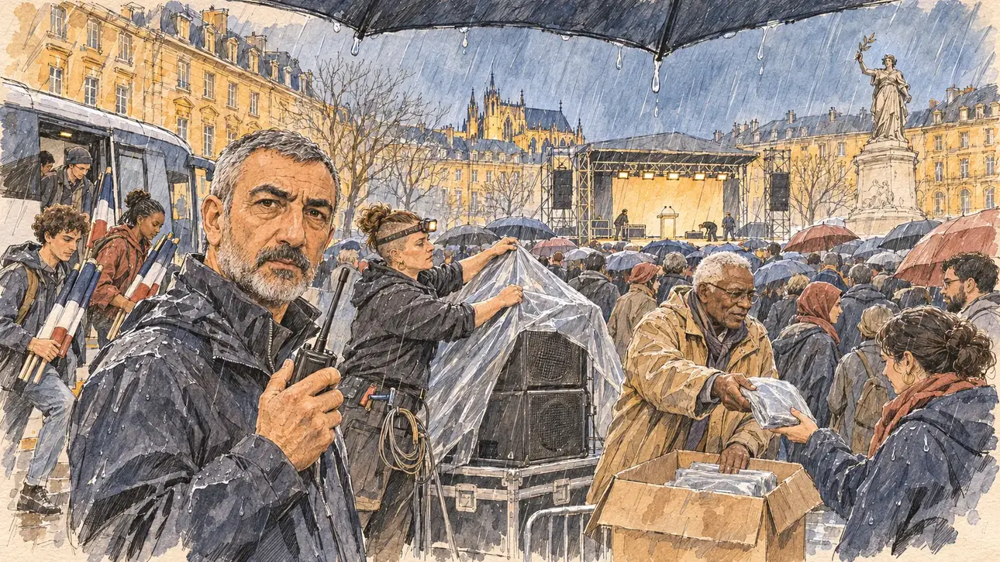

# `rainRally` · Meeting sous la pluie

**Validée par le PO le 09/11/2026**, au premier essai. Elle sert telle quelle en clair et en sombre.



| Champ | Valeur |
| --- | --- |
| Carte | `rainRally`, catégorie `touringIncident` (Contretemps de tournée), poids 0,15, en campagne officielle |
| Style | Reportage dessiné |
| Ton | Tendu, crépuscule mouillé |
| Date | 2026-11-09 |
| Outil | ChatGPT Images, à compléter (modèle et effort) |
| Conversation | À compléter |
| Format rendu | 1672 × 941 (16:9) : export en 1290 × 726 px, WebP de qualité 75, 262 Ko, sans recadrage, fait depuis la copie WebP de la conversation (à refaire depuis le PNG d'origine) |
| Fichier d'origine | À compléter (hors du dépôt) |
| Première édition | À compléter |

## Texte de la carte

> **Meeting sous la pluie**
>
> Votre grand meeting en plein air a lieu ce soir. Les prévisions annoncent une pluie battante toute la soirée, et les cars de militants arrivent déjà.

## Le moment choisi

La place de la République à Metz, au crépuscule, une heure avant un grand meeting en plein air, quand la pluie se met à tomber : les façades en pierre de Jaumont, la cathédrale au fond, la scène éclairée. Le candidat reste hors champ : le bord de son parapluie, d'où l'eau goutte. Le régisseur du meeting, talkie-walkie en main, regarde le spectateur : on maintient ? Une technicienne bâche les enceintes, un bénévole distribue des ponchos, des militants descendent d'un car avec des drapeaux tricolores, la foule ouvre ses parapluies. Metz n'avait encore servi à aucune carte.

## Prompt complet

Dans une nouvelle conversation, avec [`primeTime.webp`](../../illustrations/media/primeTime.webp) comme seule image de référence. Deux garde-fous tirés de [`flourAttack`](flourAttack.md) ferment la ligne des contraintes : pas de halo autour des lumières, la pluie en traits de crayon et non en filtre de mouchetures.

```
Use the attached image as the style reference and copy its drawing: a realistic reportage drawing made on the spot for a newspaper, with quick, nervous pencil lines, often drawn twice, ink hatching in the shadows, transparent watercolour washes that spill a little over the lines, and the warm paper showing through. Not the same scene and not the same people: never reuse the face or the hair of the woman in the reference.
Like in the reference, the setting can be full when the story needs it, with the things that say where we are and what is happening, but each one is sketched with a few pencil lines and a light wash, never rendered or finished, and the drawing gets looser and paler towards the edges until it fades into the bare paper.
This must look like a drawing made by hand on paper by a press illustrator, halfway between a quick sketch and a realistic picture: never a photograph, a film poster or a digital painting, and never a cartoon, a comic strip, a caricature or a children's book illustration. Continuous lines, never dotted or dashed outlines; no uniform texture, speckles or hatching filter laid over the picture; no glossy highlights, no smooth gradients, in the sky and on the walls too. Colour can be rich in places, on a piece of clothing, a light or a flag, but it stays transparent and within the palette below. The fade into the paper at the edges stays narrow, without a wide white margin. No blur and no depth-of-field effect: everything, the foreground included, is drawn sharp, like a sketch made on the spot.
People are drawn from life with realistic anatomy and proportions, like in the reference: faces shaped with pencil lines, hatching and light washes, a little more finished than the background but never photographic (no photographic skin, no airbrushed or digital-painting look). Expressions stay natural and restrained, even in laughter or tears: no exaggerated grins, no wide-open mouths full of teeth, no rubbery or cartoonish faces.

Editorial illustration, landscape 16:9 (1536 × 864 px), the scene filling the frame, with only a light fade into the paper at the edges. A big open-air campaign rally about to begin on the Place de la République in Metz, at dusk in March 2027, as heavy rain starts to fall: the golden-yellow Jaumont stone façades around the square, a lit stage with a sound system and a lectern at the far end, coaches parked along the square. The player's candidate stays off-camera: in the foreground, only the edge of a large dark umbrella, with rain dripping from its rim. In the left third, the rally's stage manager, a wiry man in his fifties of Turkish descent, with a grey crew cut and a trimmed grey beard, in a dark rain jacket with the hood down, a walkie-talkie in his hand, looks at the viewer with a silent question, keep going or not, his face above mid-height. Behind him: a stocky sound technician in her thirties, white, with a shaved undercut and a headlamp, pulls a plastic tarp over the speakers; a tall volunteer in his sixties of Antillean descent, with white hair and glasses, hands out folded rain ponchos from a cardboard box; young activists step down from a coach carrying rolled French tricolour flags; the crowd in front of the stage opens dozens of umbrellas, sketched into the distance under the slanting rain. Nobody poses: only the stage manager looks at the viewer. Nothing on the stage, the coaches, the box or the umbrellas is readable.

Style: Reportage drawing made on the spot, like a press illustrator or courtroom sketch artist: pencil and ink with loose watercolour washes, lively unfinished lines, white paper showing through.

Palette: navy #13203F, vellum #F5EFE1, gold #A9802A, brick #B5523B, ochre #D9A441, sage #8FA58A, slate #5E7186, sand #DCC8A4, warm grey #8C8279; use 4 to 6 of them, subtle warm paper grain.

Tone: tense, wet dusk, slanting rain drawn with a few pencil strokes, cold blue-grey light on the square against the warm gold of the stage lights and the yellow stone.

Constraints: realistic proportions, natural expressions, never cartoonish or caricatured faces, drawn like the rest of the illustration and never photographic; people of varied ages, genders, origins and body types (heavy, stocky, round, tall, short, wiry, not only slim), each with a distinct face and haircut (no two people alike), drawn with respect and never as a joke; each person's age, build and look plausible for their job and the scene (working people of working age), no stereotype tying an origin or a gender to a role, and no person of colour shown alone in a featured service or deferential role; anatomically correct hands with exactly five fingers, few hands visible, the others in pockets, behind objects or out of frame; no readable text anywhere (the stage, the coaches, the box and the umbrellas stay unreadable); no captions or speech bubbles; no logos or political party colours; no recognisable real person, no lookalike of a real politician; no explicit violence; no photographic rendering, no blur or bokeh, no dotted outlines, no texture or hatching filter over the picture, no oil-paint texture, no glow or halo around the lights, the rain drawn as pencil strokes and never as a speckle filter, no wide white margin or frame (a light fade into the paper at the edges is fine).

Format: if 16:9 is not available, make 1536 × 1024 and keep the top 80 px and the bottom 80 px free of anything important (faces, hands, the main action): they will be cropped.
```

## Décisions prises sur cette image

Validée telle quelle par le PO (09/11/2026). La statue de droite, une Marianne au rameau d'olivier sur un socle sculpté, évoque le monument de la place de la République à Paris, qui n'existe pas à Metz : le nom de la place l'a sans doute appelée. Gardée : le gabarit permet la Marianne, la cathédrale et la pierre jaune situent la scène.

## Essais écartés

Aucun.

## Retouches

Aucune.

## Relecture

Faite et validée par le PO le 09/11/2026.

- [x] Aucun texte lisible : le car, la scène, le carton et les sachets de ponchos sont vierges.
- [x] Aucun sosie d'une personne réelle.
- [x] Le candidat du joueur est hors champ : seul le bord de son parapluie, en haut de l'image.
- [x] Mains et visages sans défaut visible à 343 px de large : le talkie-walkie, la bâche, le poncho tendu et reçu, les drapeaux.
- [x] Aucune couleur ni aucun logo de parti : les drapeaux sont tricolores, ce que le gabarit permet. Des personnes variées par l'âge, le corps, l'origine et la coiffure.
- [x] En 16:9 : pas de recadrage.
- [ ] Lisible sur la page de l'événement, en clair et en sombre : à vérifier dans l'app, une fois la carte publiée.
- Les gouttes au bord du parapluie ont un léger brillant, invisible à la taille de la carte.
