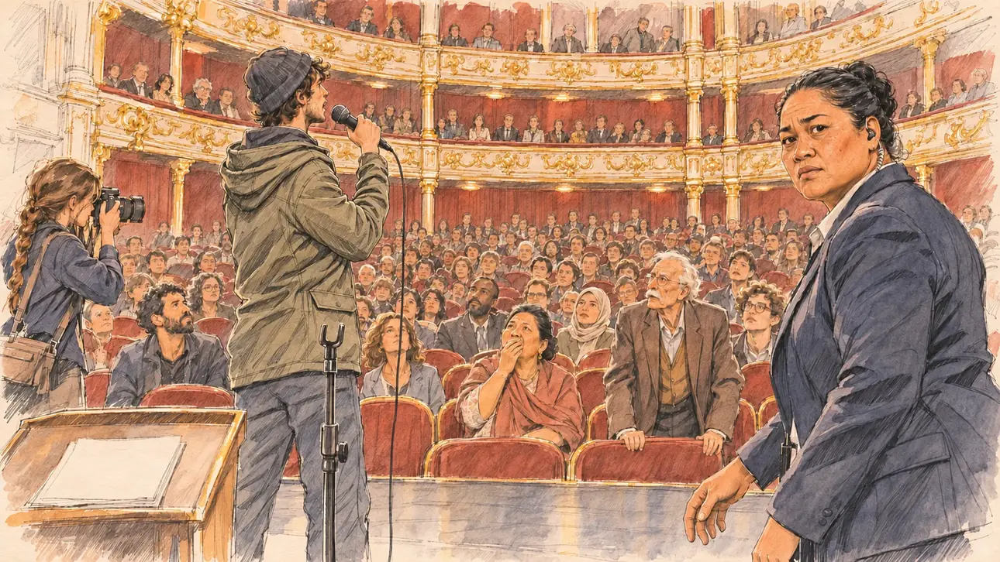

# `stageIntruder` · L'intrus sur scène

**Retenue par le PO le 16/11/2026**, au premier essai. Elle sert telle quelle en clair et en sombre.



| Champ | Valeur |
| --- | --- |
| Carte | `stageIntruder`, catégorie `touringIncident` (Contretemps de tournée), poids 0,12, toute semaine ; une leçon de la campagne (sang-froid +2 sur le calme gardé), une seule des six par partie (Mitchnsun/moi-president, PO, 14/11/2026) |
| Style | Reportage dessiné |
| Ton | Tendu, projecteurs et pénombre rouge et or |
| Date | 2026-11-16 |
| Outil | ChatGPT Images, à compléter (modèle et effort) |
| Conversation | À compléter |
| Format rendu | 1672 × 941 (16:9) : export en 1290 × 726 px, WebP de qualité 75, 190 Ko, sans recadrage, fait depuis la copie WebP de la conversation (à refaire depuis le PNG d'origine) |
| Fichier d'origine | À compléter (hors du dépôt) |
| Première édition | À compléter |

## Texte de la carte

> **L'intrus sur scène**
>
> En plein meeting, un opposant monte sur scène, vous arrache le micro et déploie une banderole devant les caméras. La salle retient son souffle.

## Le moment choisi

Un théâtre à l'italienne à Nîmes, un soir de mars, pendant un meeting : fauteuils de velours rouge, balcons dorés, le public figé. Le candidat est sur scène, hors champ : seuls son pied de micro vide et ses notes blanches sur le pupitre. L'intrus, de dos, crie vers la salle dans le micro arraché ; la cheffe de la sécurité s'avance et jette un regard au candidat : on intervient ? Au premier rang, une militante porte la main à sa bouche, un militant âgé s'est levé ; une photographe mitraille. Les précédents sont la gifle de Tain-l'Hermitage (juin 2021), après laquelle le président a poursuivi sa visite, et « La République, c'est moi » (octobre 2018) : personne n'y ressemble à un responsable politique ou à un militant connu.

## Prompt complet

Dans une nouvelle conversation, avec [`primeTime.webp`](../../illustrations/media/primeTime.webp) comme seule image de référence :

```
Use the attached image as the style reference and copy its drawing: a realistic reportage drawing made on the spot for a newspaper, with quick, nervous pencil lines, often drawn twice, ink hatching in the shadows, transparent watercolour washes that spill a little over the lines, and the warm paper showing through. Not the same scene and not the same people: never reuse the face or the hair of the woman in the reference.
Like in the reference, the setting can be full when the story needs it, with the things that say where we are and what is happening, but each one is sketched with a few pencil lines and a light wash, never rendered or finished, and the drawing gets looser and paler towards the edges until it fades into the bare paper.
This must look like a drawing made by hand on paper by a press illustrator, halfway between a quick sketch and a realistic picture: never a photograph, a film poster or a digital painting, and never a cartoon, a comic strip, a caricature or a children's book illustration. Continuous lines, never dotted or dashed outlines; no uniform texture, speckles or hatching filter laid over the picture; no glossy highlights, no smooth gradients, in the sky and on the walls too. Colour can be rich in places, on a piece of clothing, a light or a flag, but it stays transparent and within the palette below. The fade into the paper at the edges stays narrow, without a wide white margin. No blur and no depth-of-field effect: everything, the foreground included, is drawn sharp, like a sketch made on the spot.
People are drawn from life with realistic anatomy and proportions, like in the reference: faces shaped with pencil lines, hatching and light washes, a little more finished than the background but never photographic (no photographic skin, no airbrushed or digital-painting look). Expressions stay natural and restrained, even in laughter or tears: no exaggerated grins, no wide-open mouths full of teeth, no rubbery or cartoonish faces.

Editorial illustration, landscape 16:9 (1536 × 864 px), the scene filling the frame, with only a light fade into the paper at the edges. The stage of an Italian-style theatre in Nîmes, in the south of France, on an evening in March 2027, during a campaign rally: red velvet seats, gilded balconies, spotlights on the stage, the audience frozen. The player's candidate stands on the stage and stays off-camera: in the foreground, only the candidate's empty microphone stand and blank notes on the lectern. In the centre of the stage, the intruder, a tall, lanky young man in his twenties in a beanie and a parka, holds the snatched microphone in one hand and unfurls a white banner with no letters with the other, shouting towards the audience, not looking at the viewer. In the right third, the head of security, a stocky woman in her forties of Polynesian descent with black hair in a bun, an earpiece and a dark suit, steps forward and glances at the viewer, as if asking whether to step in, her face above mid-height. In the front row: a round supporter in her fifties of Cambodian descent puts a hand to her mouth; a thin elderly supporter with a white moustache has stood up. At the side of the stage, a press photographer, a young woman with a long braid, takes pictures. Only the head of security looks at the viewer. Nothing on the banner, the notes, the lectern, the microphone or the camera is readable.

Style: Reportage drawing made on the spot, like a press illustrator or courtroom sketch artist: pencil and ink with loose watercolour washes, lively unfinished lines, white paper showing through.

Palette: navy #13203F, vellum #F5EFE1, gold #A9802A, brick #B5523B, ochre #D9A441, sage #8FA58A, slate #5E7186, sand #DCC8A4, warm grey #8C8279; use 4 to 6 of them, subtle warm paper grain.

Tone: tense, the harsh light of the spotlights on the stage, the hall in a red and gold half-light.

Constraints: realistic proportions, natural expressions, never cartoonish or caricatured faces, drawn like the rest of the illustration and never photographic; people of varied ages, genders, origins and body types (heavy, stocky, round, tall, short, wiry, not only slim), each with a distinct face and haircut (no two people alike), drawn with respect and never as a joke; each person's age, build and look plausible for their job and the scene (working people of working age), no stereotype tying an origin or a gender to a role, and no person of colour shown alone in a featured service or deferential role; the intruder drawn with respect, not as a villain; anatomically correct hands with exactly five fingers, few hands visible, the others in pockets, behind objects or out of frame; no readable text anywhere (the banner, the notes, the lectern, the microphone and the camera stay unreadable, no slogans); no captions or speech bubbles; no logos, no television channel logo, no political party colours, no flags, nothing that identifies the intruder's side; no recognisable real person, no lookalike of a real politician or activist; no explicit violence, no one grabbed or hit, no weapon; no photographic rendering, no blur or bokeh, every outline a continuous pencil or ink line with no dotted or dashed outlines, no mottled, crackled or speckled texture over the faces, the clothes, the velvet or the gilding, no hatching filter over the picture, no oil-paint texture, no glow, halo or lens flare around the spotlights, no wide white margin or frame (a light fade into the paper at the edges is fine).

Format: if 16:9 is not available, make 1536 × 1024 and keep the top 80 px and the bottom 80 px free of anything important (faces, hands, the main action): they will be cropped.
```

## Décisions prises sur cette image

Retenue telle quelle par le PO (16/11/2026). L'intrus est de dos et n'a pas de banderole, seulement le micro arraché : le texte de la carte la décrit, l'image s'en passe. Rien ne dit son camp.

## Essais écartés

Aucun.

## Retouches

Aucune.

## Relecture

Faite le 16/11/2026, à confirmer par le PO.

- [x] Aucun texte lisible : notes blanches ; rien sur le pupitre, le micro ni l'appareil.
- [x] Aucun sosie d'une personne réelle ; rien ne dit le camp de l'intrus.
- [x] Le candidat du joueur est hors champ : seuls son pied de micro vide et ses notes.
- [x] Mains et visages sans défaut visible à 343 px de large : la main de l'intrus sur le micro, celle de la cheffe de la sécurité, la main devant la bouche de la militante, celles du militant sur le dossier du fauteuil.
- [x] Aucune couleur, aucun logo ni aucun drapeau de parti. Des personnes variées par l'âge, le corps, l'origine et la coiffure.
- [x] En 16:9 : pas de recadrage.
- [ ] Lisible sur la page de l'événement, en clair et en sombre : à vérifier dans l'app, une fois la carte publiée.
