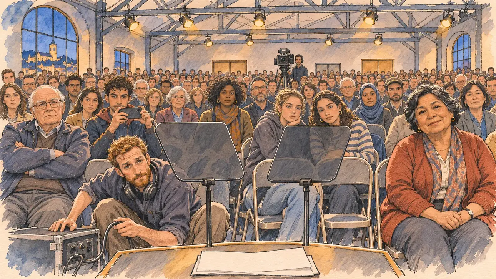

# `stumblingSpeech` · Le discours qui bute

**Retenue par le PO le 16/11/2026**, au premier essai. Elle sert telle quelle en clair et en sombre.



| Champ | Valeur |
| --- | --- |
| Carte | `stumblingSpeech`, catégorie `touringIncident` (Contretemps de tournée), poids 0,15, toute semaine ; une leçon gagnée sur une faiblesse (charisme +3, jet inversé), une seule de la série par partie (Mitchnsun/moi-president, PO, 16/11/2026) |
| Style | Reportage dessiné |
| Ton | Suspendu et chaleureux |
| Date | 2026-11-16 |
| Outil | ChatGPT Images, modèle GPT 6.2, effort Light |
| Conversation | À compléter |
| Format rendu | 1672 × 941 (16:9) : export en 1290 × 726 px, WebP de qualité 75, 204 Ko, sans recadrage, fait depuis la copie WebP de la conversation |
| Fichier d'origine | Image de ChatGPT, chez le PO. L'export du dépôt a été fait depuis la copie partagée dans la conversation avec Claude |
| Première édition | `kit-france-2611-0004` |

## Texte de la carte

> **Le discours qui bute**
>
> En plein meeting, le prompteur tombe en panne devant mille personnes, et vous perdez le fil. La salle attend la suite, les caméras tournent.

## Le moment choisi

La salle des fêtes de Limoges, un soir de février : mille personnes sur des chaises pliantes, une charpente métallique et des projecteurs, la ville et son clocher par les fenêtres cintrées ; devant le pupitre, les deux vitres du prompteur, noires. Le candidat est au pupitre, hors champ : seules ses notes papier, sur le pupitre. Au premier rang, une militante lui fait signe d'y aller ; au pied de la scène, le technicien accroupi près de son boîtier lève un regard d'excuse ; dans la salle, un jeune homme filme, deux lycéennes attendent, un vieux monsieur croise les bras ; une caméra au fond. Le précédent est un candidat ouvrier, orateur sans éclat, qui a crevé l'écran au débat des onze candidats (avril 2017) : personne n'y ressemble à un responsable politique.

## Prompt complet

Dans une nouvelle conversation, avec [`primeTime.webp`](../../illustrations/media/primeTime.webp) comme seule image de référence :

```
Use the attached image as the style reference and copy its drawing: a realistic reportage drawing made on the spot for a newspaper, with quick, nervous pencil lines, often drawn twice, ink hatching in the shadows, transparent watercolour washes that spill a little over the lines, and the warm paper showing through. Not the same scene and not the same people: never reuse the face or the hair of the woman in the reference.
Like in the reference, the setting can be full when the story needs it, with the things that say where we are and what is happening, but each one is sketched with a few pencil lines and a light wash, never rendered or finished, and the drawing gets looser and paler towards the edges until it fades into the bare paper.
This must look like a drawing made by hand on paper by a press illustrator, halfway between a quick sketch and a realistic picture: never a photograph, a film poster or a digital painting, and never a cartoon, a comic strip, a caricature or a children's book illustration. Continuous lines, never dotted or dashed outlines; no uniform texture, speckles or hatching filter laid over the picture; no glossy highlights, no smooth gradients, in the sky and on the walls too. Colour can be rich in places, on a piece of clothing, a light or a flag, but it stays transparent and within the palette below. The fade into the paper at the edges stays narrow, without a wide white margin. No blur and no depth-of-field effect: everything, the foreground included, is drawn sharp, like a sketch made on the spot.
People are drawn from life with realistic anatomy and proportions, like in the reference: faces shaped with pencil lines, hatching and light washes, a little more finished than the background but never photographic (no photographic skin, no airbrushed or digital-painting look). Expressions stay natural and restrained, even in laughter or tears: no exaggerated grins, no wide-open mouths full of teeth, no rubbery or cartoonish faces.

Editorial illustration, landscape 16:9 (1536 × 864 px), the scene filling the frame, with only a light fade into the paper at the edges. A community hall in Limoges, in the Limousin, central France, on an evening in February 2027, during a campaign rally, the moment the teleprompter breaks down: a medium-sized hall with a thousand people on folding chairs, a ceiling of metal beams with rows of spotlights; in front of the lectern, the two glass panes of the teleprompter have gone dark and blank. The player's candidate stands at the lectern and stays off-camera: in the foreground, only the candidate's folded paper notes on the lectern. In the right third, in the front row, a supporter in her sixties of Peruvian descent, short and round, with greying black hair cut short, in a brick-red cardigan, looks at the viewer with a kind, encouraging nod, as if saying go on, just talk to us, her face above mid-height. At the foot of the stage, the teleprompter technician, a tall, thin white man in his thirties with a ginger beard and headphones around his neck, crouches by a control box with a cable in his hand and looks up at the viewer apologetically. In the hall: a young man films with his phone, two high-school girls whisper, a heavy-set old man waits with his arms crossed. At the back, a television camera on a tripod. Only the supporter and the technician look at the viewer. Nothing on the teleprompter, the notes, the lectern, the control box or the camera is readable.

Style: Reportage drawing made on the spot, like a press illustrator or courtroom sketch artist: pencil and ink with loose watercolour washes, lively unfinished lines, white paper showing through.

Palette: navy #13203F, vellum #F5EFE1, gold #A9802A, brick #B5523B, ochre #D9A441, sage #8FA58A, slate #5E7186, sand #DCC8A4, warm grey #8C8279; use 4 to 6 of them, subtle warm paper grain.

Tone: suspended and warm, the yellow light of the spotlights, the dark panes of the teleprompter at the centre of the picture, a hall holding its breath.

Constraints: realistic proportions, natural expressions, never cartoonish or caricatured faces, drawn like the rest of the illustration and never photographic; people of varied ages, genders, origins and body types (heavy, stocky, round, tall, short, wiry, not only slim), each with a distinct face and haircut (no two people alike), drawn with respect and never as a joke; each person's age, build and look plausible for their job and the scene (working people of working age), no stereotype tying an origin or a gender to a role, and no person of colour shown alone in a featured service or deferential role; anatomically correct hands with exactly five fingers, few hands visible, the others in pockets, behind objects or out of frame; no readable text anywhere (the teleprompter, the notes, the lectern, the control box and the camera stay unreadable, no words on the teleprompter panes, no banners with words); no captions or speech bubbles; no logos, no television channel logo, no political party colours or flags in the hall; no recognisable real person, no lookalike of a real politician; no image of the candidate anywhere; no explicit violence; no photographic rendering, no blur or bokeh, every outline a continuous pencil or ink line with no dotted or dashed outlines, no mottled, crackled or speckled texture over the faces, the clothes or the hall, no hatching filter over the picture, no oil-paint texture, no glow, halo or lens flare around the spotlights, no wide white margin or frame (a light fade into the paper at the edges is fine).

Format: if 16:9 is not available, make 1536 × 1024 and keep the top 80 px and the bottom 80 px free of anything important (faces, hands, the main action): they will be cropped.
```

## Décisions prises sur cette image

Retenue telle quelle par le PO (16/11/2026). Toute la salle regarde le spectateur, pas seulement les deux personnages demandés : c'est le candidat qu'elle attend, au pupitre, et le silence de la salle y gagne.

## Essais écartés

Aucun.

## Retouches

Aucune.

## Relecture

Faite le 16/11/2026, à confirmer par le PO.

- [x] Aucun texte lisible : les vitres du prompteur sont noires, les notes blanches ; rien sur le boîtier ni la caméra.
- [x] Aucun sosie d'une personne réelle ; aucune image du candidat.
- [x] Le candidat du joueur est hors champ : seules ses notes, sur le pupitre.
- [x] Mains et visages sans défaut visible à 343 px de large : les mains du technicien sur le boîtier et le câble, celles de la militante sur ses genoux, celles du jeune homme au téléphone.
- [x] Aucune couleur, aucun logo ni aucun drapeau de parti dans la salle. Des personnes variées par l'âge, le corps, l'origine et la coiffure.
- [x] En 16:9 : pas de recadrage.
- [ ] Lisible sur la page de l'événement, en clair et en sombre : à vérifier dans l'app, une fois la carte publiée.
