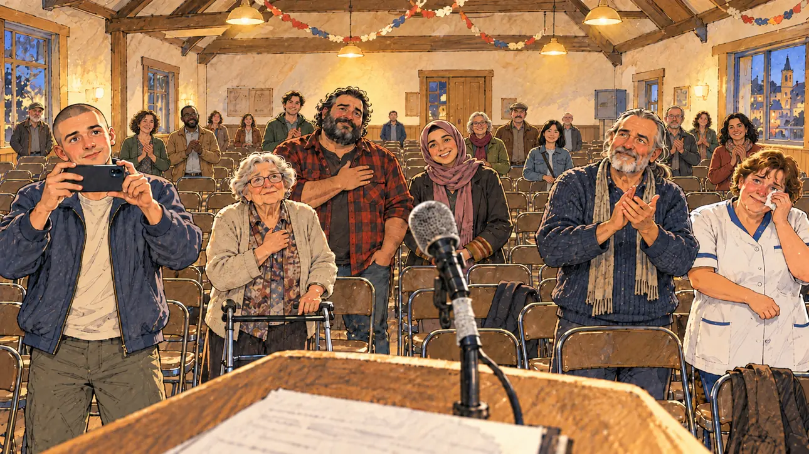

# `viralSpeech` · Un discours qui décolle

**Validée par le PO le 31/10/2026**, à l'essai 2. Elle sert telle quelle en clair et en sombre.



| Champ | Valeur |
| --- | --- |
| Carte | `viralSpeech`, catégorie `breakthrough` (Coup de projecteur) |
| Style | Reportage dessiné ; visages dessinés comme le reste |
| Ton | Chaleureux et vibrant |
| Date | 2026-10-31 |
| Outil | ChatGPT, ChatGPT Images 2.5 ; mode et effort : non précisés |
| Conversation | À remplir (le lien ne s'ouvre qu'avec le compte qui l'a créée) |
| Format rendu | 1672 × 941 (16:9) : export en 1290 × 726 px depuis le PNG d'origine, WebP de qualité 75, 163 Ko, sans recadrage |
| Fichier d'origine | PNG de ChatGPT, chez le PO, partagé aussi dans la conversation avec Claude |
| Première édition | À remplir |

## Texte de la carte

> **Un discours qui décolle**
>
> Salle des fêtes à moitié vide, micro qui grésille. Mais ce soir, quelque chose se passe : le public vibre, et un militant filme.

## Le moment choisi

Une salle des fêtes à moitié vide, vue depuis l'estrade où parle le candidat : un pupitre bon marché et un vieux micro au câble scotché. Les quelques présents sont debout, émus ; au premier rang, un jeune militant filme. Ici, que tout le monde regarde le candidat est voulu : ils écoutent le discours.

## Prompt complet

Dans une nouvelle conversation, avec [`oldTweet.webp`](oldTweet.webp) comme seule image de référence :

```
Use the attached image as the style reference: the same pencil and ink drawing with loose watercolour washes and warm paper grain. Not the same scene.
Faces are drawn exactly like the clothes and the background: ink outlines, a few hatching strokes and flat watercolour washes for the skin, with the same level of detail as the rest of the drawing. No photographic skin, no realistic shading, no airbrushed or digital-painting look on the faces.

Editorial illustration, landscape 16:9 (1536 × 864 px), filling the whole frame edge to edge. A small-town village hall in France, on a weekday evening in 2027, during a campaign meeting. The hall is half empty: rows of folding chairs, many of them unoccupied, a few paper garlands left over from a village party. The scene is seen from the little stage where the player's candidate is speaking, the candidate staying off-camera: in the foreground, only the top of a cheap lectern and an old microphone on a stand, its cable held with tape. And yet, tonight, something is happening: the thirty people in the room are on their feet, moved, all looking at the viewer. In the left third, in the aisle, a young activist with a buzz cut and a plain campaign badge films the viewer with his smartphone held sideways, his eyes shining, his face above mid-height. Around the room: an old woman standing up with the help of her walker; a big bearded man in a lumberjack shirt, his hand on his heart; a teenage girl in a headscarf with a wide smile; a man in his fifties with long grey hair in a ponytail, clapping; a short, round woman in a nurse's tunic, wiping her eyes. Nothing on the walls, the badge or the screens is readable.

Style: Reportage drawing made on the spot, like a press illustrator or courtroom sketch artist: pencil and ink with loose watercolour washes, lively unfinished lines, white paper showing through.

Palette: navy #13203F, vellum #F5EFE1, gold #A9802A, brick #B5523B, ochre #D9A441, sage #8FA58A, slate #5E7186, sand #DCC8A4, warm grey #8C8279; use 4 to 6 of them, subtle warm paper grain.

Tone: warm and stirring, yellow light from old ceiling lamps, a sense of a moment that tips.

Constraints: realistic proportions, expressive but not caricatured faces, drawn like the rest of the illustration and never photographic; people of varied ages, genders, origins and body types (heavy, stocky, round, tall, short, wiry, not only slim), each with a distinct face and haircut (no two people alike), drawn with respect and never as a joke; anatomically correct hands with exactly five fingers, few hands visible, the others in pockets, behind objects or out of frame; no readable text anywhere (walls, badges, signs and screens stay unreadable); no captions or speech bubbles; no logos or political party colours; no recognisable real person, no lookalike of a real politician; no explicit violence; no oil-paint texture, no white or ragged border.

Format: if 16:9 is not available, make 1536 × 1024 and keep the top 80 px and the bottom 80 px free of anything important (faces, hands, the main action): they will be cropped.
```

### Message de correction

Envoyé après l'essai 1 :

```
Keep this image, the style and the six people in the front exactly as they are, but empty the back of the hall: remove most of the people behind them, leaving many rows of empty folding chairs and only a handful of scattered people standing, so that the hall is clearly half empty. Keep every hand anatomically correct, with five fingers, and no readable text anywhere.
```

## Essais écartés

- **Essai 1** (31/10/2026) : les six personnages du premier rang étaient justes, mais une cinquantaine de personnes remplissaient le fond. La salle n'était plus « à moitié vide », et le contraste de la carte se perdait.

## Retouches

Aucune.

## Relecture

Faite et validée par le PO le 31/10/2026, sur l'essai 2.

- [x] Aucun texte lisible : ni sur les murs, ni sur le badge, ni sur les notes du discours.
- [x] Aucun sosie d'une personne réelle.
- [x] Le candidat du joueur est hors champ.
- [x] Mains, visages et foules sans défaut visible à 343 px de large.
- [x] Aucune couleur de parti, aucun symbole officiel. Des personnes variées par l'âge, le corps, l'origine et la coiffure.
- [x] En 3:2 : rien d'important dans les 80 px du haut et du bas. Sans objet ici : l'image est en 16:9.
- [x] Lisible sur la page de l'événement, en clair et en sombre.
