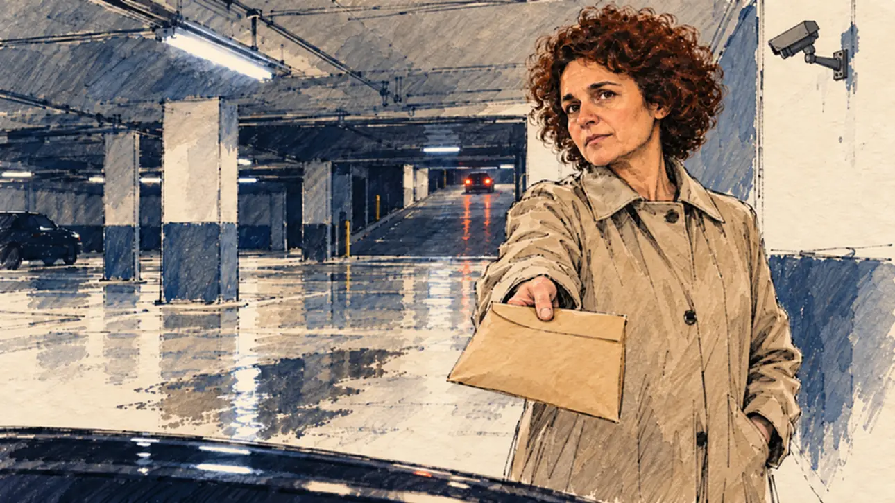

# `whistleblower` · Une lanceuse d'alerte

**Validée par le PO le 31/10/2026**, au premier essai de la méthode en deux étapes (portrait dessiné, puis scène). Elle sert telle quelle en clair et en sombre.



| Champ | Valeur |
| --- | --- |
| Carte | `whistleblower`, catégorie `breakthrough` (Coup de projecteur) |
| Style | Reportage dessiné ; le visage de la lanceuse d'alerte reste presque photographique (accepté par le PO) |
| Ton | Grave, atmosphère de film noir |
| Date | 2026-10-31 |
| Outil | ChatGPT, ChatGPT Images 2.5 ; mode et effort : non précisés |
| Conversation | À remplir (le lien ne s'ouvre qu'avec le compte qui l'a créée) |
| Format rendu | 1674 × 940 (16:9) : export en 1290 × 726 px depuis le PNG d'origine, WebP de qualité 75, 110 Ko, sans recadrage |
| Fichier d'origine | PNG de ChatGPT, chez le PO, partagé aussi dans la conversation avec Claude |
| Première édition | À remplir |

## Texte de la carte

> **Une lanceuse d'alerte**
>
> Une lanceuse d'alerte vous confie des documents explosifs sur un grand groupe et ses amis au ministère. Elle ne fait confiance qu'à vous.

## Le moment choisi

Un parking souterrain parisien, la nuit, presque vide, comme dans un vieux thriller politique : piliers de béton, néons, sol mouillé, une voiture qui remonte la rampe. La lanceuse d'alerte, en imperméable beige, tend une enveloppe kraft au candidat et le regarde droit dans les yeux, grave. Le candidat est hors champ : au premier plan, seulement le toit de sa voiture.

## Prompt complet

En deux étapes, pour que la scène ne voie jamais la photo de famille.

### Étape 1 : le portrait dessiné

Dans une nouvelle conversation, avec deux images jointes : [`oldTweet.webp`](oldTweet.webp) pour le style, puis une photo de famille du PO. Le portrait obtenu n'est pas dans ce dépôt.

```
Use the first attached image as the style reference: the same pencil and ink drawing with loose watercolour washes and warm paper grain.
The second attached image is a photograph. Draw a new portrait of this woman, as a press illustrator or courtroom sketch artist would draw a quick likeness from life: head and shoulders, three-quarter view, with a calm, serious expression, in a plain dark top without the necklace, on plain warm paper with no background.
Do not trace or copy the photograph. Redraw the face from scratch and keep only what makes her recognisable: the shape of the face, the short, thick dark-brown curly hair, the eyebrows, the eyes, the nose and the mouth. Everything is drawn with ink outlines, hatching and flat watercolour washes, simplified like the faces in the reference image. No photographic skin, no photographic lighting, no detail taken over from the photo's texture.
Format: square, 1024 × 1024 px.
```

### Étape 2 : la scène

Dans une nouvelle conversation, avec deux images jointes : [`oldTweet.webp`](oldTweet.webp) pour le style, puis le portrait dessiné de l'étape 1 pour la ressemblance de la lanceuse d'alerte.

```
Use the first attached image as the style reference: the same pencil and ink drawing with loose watercolour washes and warm paper grain. Not the same scene.
Use the second attached image, a drawn portrait, only as the likeness reference for the whistleblower: give her this woman's features and short, thick dark-brown curly hair, and draw her face with the same ink lines and washes as the rest of the scene. Keep the likeness through the drawing, never through photographic detail.
This must look like a drawing made by hand on paper, never like a photograph: the person is drawn with ink lines and flat washes, not modelled; large parts of the background are only suggested with a few pencil lines and a wash, leaving the warm paper bare.
Faces are drawn exactly like the clothes and the background: ink outlines, a few hatching strokes and flat watercolour washes for the skin, with the same level of detail as the rest of the drawing. No photographic skin, no realistic wrinkles or pores, no airbrushed or digital-painting look on the face.

Editorial illustration, landscape 16:9 (1536 × 864 px), filling the whole frame edge to edge. An underground car park in Paris, late at night in 2027, almost empty, like a scene from an old political thriller: concrete pillars, a flickering strip light, a puddle on the ground, the exit ramp in the distance. A whistleblower has asked to meet the player's candidate here, alone. The candidate stays off-camera: in the foreground, only the edge of the roof of the candidate's small car. In the right third, the whistleblower, the woman from the portrait, around fifty, in a beige raincoat buttoned up to the neck, a company badge turned face down on its lanyard, holds out a thick, sealed brown envelope towards the viewer with one hand, the other hand in her pocket. She looks straight at the viewer, serious and tired, the face of someone who has hesitated for months and trusts only this person, her face above mid-height. Behind her, far away, the red rear lights of a car going up the ramp, and a security camera turned towards the wall. Nobody else is there. Nothing on the envelope, the badge, the pillars or the signs is readable.

Style: Reportage drawing made on the spot, like a press illustrator or courtroom sketch artist: pencil and ink with loose watercolour washes, lively unfinished lines, white paper showing through.

Palette: navy #13203F, vellum #F5EFE1, gold #A9802A, brick #B5523B, ochre #D9A441, sage #8FA58A, slate #5E7186, sand #DCC8A4, warm grey #8C8279; use 4 to 6 of them, subtle warm paper grain.

Tone: tense and grave, film-noir atmosphere, cold strip light and deep shadows, with one warm note on her face.

Constraints: realistic proportions, an expressive but not caricatured face, drawn like the rest of the illustration and never photographic; the whistleblower drawn with respect; anatomically correct hands with exactly five fingers, few hands visible; no readable text anywhere (envelope, badge, pillar numbers and signs stay unreadable); no captions or speech bubbles; no logos or political party colours; apart from the likeness of the woman in the portrait, no recognisable real person and no lookalike of a real whistleblower, politician or actress; no explicit violence; no photographic rendering, no hatching filter over a finished digital painting, no oil-paint texture, no white or ragged border.

Format: if 16:9 is not available, make 1536 × 1024 and keep the top 80 px and the bottom 80 px free of anything important (faces, hands, the main action): they will be cropped.
```

## Décisions prises sur cette image

- **La lanceuse d'alerte reprend les traits d'une photo de famille fournie par le PO**, avec l'accord de la personne, confirmé par le PO (31/10/2026). Ni la photo ni le portrait dessiné ne sont dans ce dépôt.
- **Le visage reste presque photographique,** malgré la méthode en deux étapes : il contraste avec l'imperméable et le parking dessinés. Le PO garde l'image telle quelle.
- **La lanceuse d'alerte n'est plus « corpulente » et ne porte plus de lunettes,** comme dans le premier prompt : on ne change ni la silhouette ni le visage d'une personne réelle.
- **La caméra de surveillance vise la scène** au lieu d'être tournée vers le mur. Elle se lit aussi : quelqu'un pourrait regarder.

## Essais écartés

Aucune image écartée. Le premier prompt, sans ressemblance, a été remplacé avant génération par les deux étapes ci-dessus :

```
Use the attached image as the style reference: the same pencil and ink drawing with loose watercolour washes and warm paper grain. Not the same scene.
This must look like a drawing made by hand on paper, never like a photograph: the person is drawn with ink lines and flat washes, not modelled; large parts of the background are only suggested with a few pencil lines and a wash, leaving the warm paper bare.
Faces are drawn exactly like the clothes and the background: ink outlines, a few hatching strokes and flat watercolour washes for the skin, with the same level of detail as the rest of the drawing. No photographic skin, no realistic wrinkles or pores, no airbrushed or digital-painting look on the face.

Editorial illustration, landscape 16:9 (1536 × 864 px), filling the whole frame edge to edge. An underground car park in Paris, late at night in 2027, almost empty, like a scene from an old political thriller: concrete pillars, a flickering strip light, a puddle on the ground, the exit ramp in the distance. A whistleblower has asked to meet the player's candidate here, alone. The candidate stays off-camera: in the foreground, only the edge of the roof of the candidate's small car. In the right third, the whistleblower, a heavy-set woman in her late forties with short salt-and-pepper curly hair and thin metal glasses, in a beige raincoat buttoned up to the neck, a company badge turned face down on its lanyard, holds out a thick, sealed brown envelope towards the viewer with one hand, the other hand in her pocket. She looks straight at the viewer, serious and tired, the face of someone who has hesitated for months and trusts only this person, her face above mid-height. Behind her, far away, the red rear lights of a car going up the ramp, and a security camera turned towards the wall. Nobody else is there. Nothing on the envelope, the badge, the pillars or the signs is readable.

Style: Reportage drawing made on the spot, like a press illustrator or courtroom sketch artist: pencil and ink with loose watercolour washes, lively unfinished lines, white paper showing through.

Palette: navy #13203F, vellum #F5EFE1, gold #A9802A, brick #B5523B, ochre #D9A441, sage #8FA58A, slate #5E7186, sand #DCC8A4, warm grey #8C8279; use 4 to 6 of them, subtle warm paper grain.

Tone: tense and grave, film-noir atmosphere, cold strip light and deep shadows, with one warm note on her face.

Constraints: realistic proportions, an expressive but not caricatured face, drawn like the rest of the illustration and never photographic; the whistleblower drawn with respect; anatomically correct hands with exactly five fingers, few hands visible; no readable text anywhere (envelope, badge, pillar numbers and signs stay unreadable); no captions or speech bubbles; no logos or political party colours; no recognisable real person, no lookalike of a real whistleblower, politician or actress; no explicit violence; no photographic rendering, no hatching filter over a finished digital painting, no oil-paint texture, no white or ragged border.

Format: if 16:9 is not available, make 1536 × 1024 and keep the top 80 px and the bottom 80 px free of anything important (faces, hands, the main action): they will be cropped.
```

## Retouches

Aucune.

## Relecture

Faite et validée par le PO le 31/10/2026.

- [x] Aucun texte lisible : ni sur l'enveloppe, ni sur les piliers.
- [x] Aucun sosie d'une personne réelle, hors la ressemblance voulue de la lanceuse d'alerte.
- [x] Le candidat du joueur est hors champ.
- [x] Mains et visage sans défaut visible à 343 px de large.
- [x] Aucune couleur de parti, aucun symbole officiel.
- [x] En 3:2 : rien d'important dans les 80 px du haut et du bas. Sans objet ici : l'image est en 16:9.
- [x] Lisible sur la page de l'événement, en clair et en sombre.
